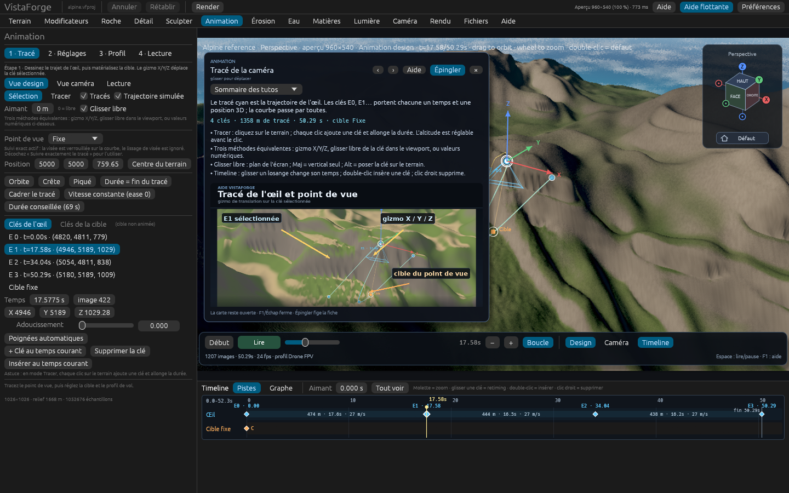
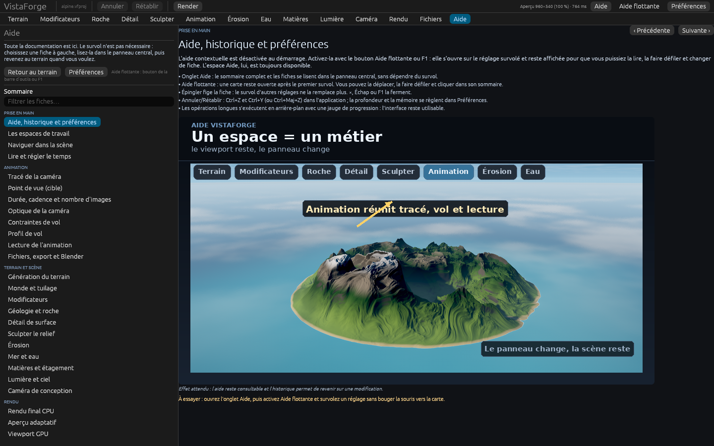
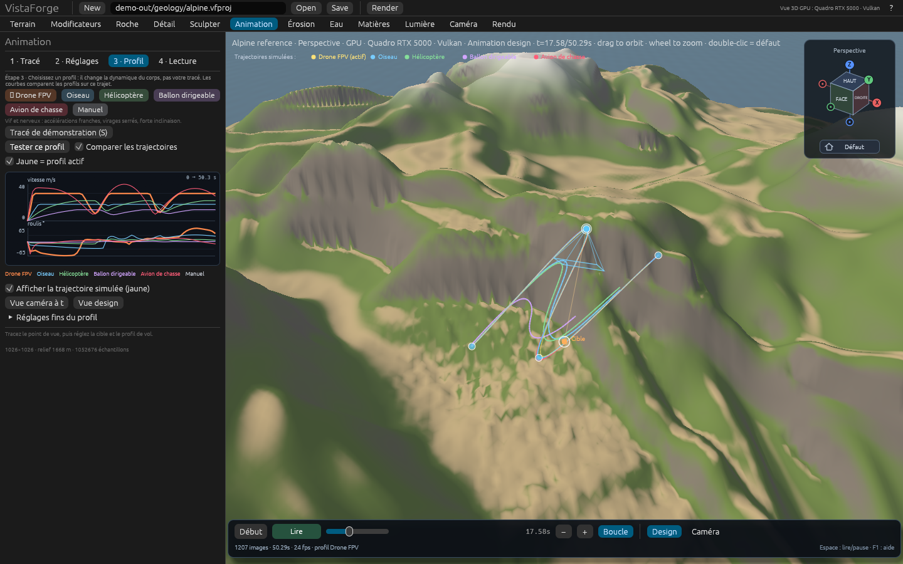
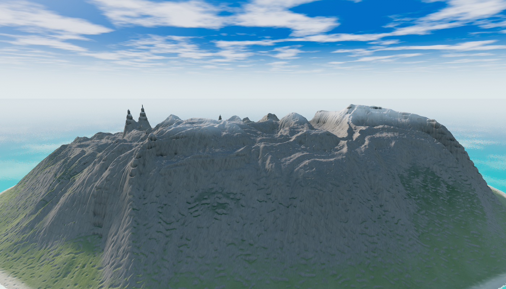
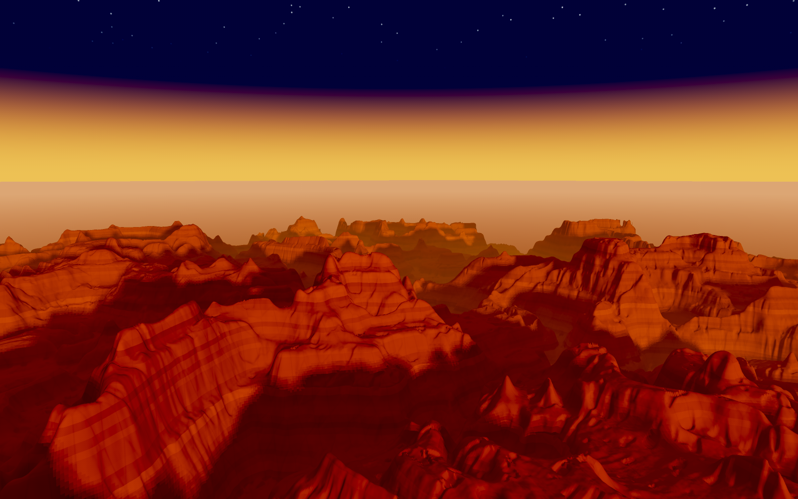

# VistaForge

**Générateur et éditeur de paysages 2.5D moderne**, écrit en Rust 2024.
Terrain fractal ou DEM réel, éclairage solaire, ciel et nuages procéduraux, eau, rendu PNG déterministe,
projet `.vfproj`, CLI, interface de bureau et serveur MCP.


## Ce qui fonctionne

- **Terrain** : génération Classic (midpoint displacement, seed, dimension fractale, diviseur, île) et Modern
  (fBm, ridged multifractal, domain warp, presets, cratères, terrasses, bordure insulaire).
- **Détail continu** : champ fractal multi-échelle évalué au-dessus du DEM, band-limité par l'empreinte pixel,
  profils granite/basalte/calcaire/grès/schiste/craie/volcanique/canyon/Patagonie, patch de gros plan
  à 2–50 cm, sillons, arêtes, cratères, exfoliation, vésicules. Maillage subdivisé 1–4×,
  **adaptatif par blocs de 64 cellules** avec jupes de raccord, budget de 6 M de sommets.
- **Édition** : érosion hydraulique + thermique, lissage, ré-échantillonnage bicubique, brosses,
  normalisation, statistiques, masque de validité.
- **Modificateurs** : pile live de 27 opérateurs — Displace, Warp, Transform, Swirl, Terrace,
  Fold, Stratify, Grooves, Ridges, Crater field, Exfoliate, Vesicles, Undercut, Aperture,
  Clamp, Blur, Sharpen, Crater, Recast cliff, Erosion, Thermal, Alluvium, Snow, Dunes, Talus,
  Combine, BiasGain — appliquée au rendu, éditable au CLI, dans l'UI et via MCP, avec cuisson
  (`bake`).
- **Géologie** : modèle de roche procédural — strates pendées avec dureté par banc, joints
  orthogonaux et colonnes basaltiques, dissolution karstique, détail de surface. Presets
  `granite`, `basalt`, `limestone`, `sandstone`, `schist`, `chalk`, `volcanic`, appliqués avant
  l'érosion et relus par le shader pour colorer les bancs.
- **DEM et heightmaps** : GeoTIFF 32 bits géoréférencé (lecture/écriture), ESRI ASCII
  Grid, DEM legacy v1, import PNG/TIFF/JPEG avec plage d'altitude ou sidecar JSON,
  export PNG 16 bits + world file, masque nodata.
- **Scène** : caméra look-at/orbite, ciel crépusculaire avec étoiles, canyon creusé,
  soleil (azimut boussole 0 = sud, 90 = ouest), palettes
  alpine/désert/volcanique/côtier/canyon/lunaire/île, brume, exposition, contraste, saturation.
- **Navigation CAO** : gizmo d'orientation à trois axes dans le viewport (cube cliquable
  face/arrière/gauche/droite/dessus/dessous, triade X/Y/Z), retour à la vue par défaut
  d'un clic, double-clic ou raccourcis `1` face, `2` dessus, `3` droite, `0`/`Home` défaut.
- **Viewport 3D GPU** : rendu interactif wgpu — **Vulkan** sous Linux/Windows, Metal sur macOS —
  avec ciel, relief ombré, eau et brouillard. La caméra et le zoom restent à 60 fps ;
  le rendu final déterministe reste sur le rasteriseur CPU. Repli `VISTAFORGE_RENDERER=glow`
  et bascule dans le panneau **Rendu**.
- **Aperçu adaptatif** : pendant une interaction, l'aperçu CPU descend jusqu'à 25 % de sa
  résolution, puis se raffine progressivement (50 → 75 → 100 %) dès que la main s'arrête.
  La résolution cible est apprise du temps de rendu mesuré (budget ~45 ms).
- **Rendu CPU déterministe** : rasterisation tuilée multi-thread, z-buffer, PCF 5×5, AO
  multi-échelle à courbe HBAO, ombres 4096 en qualité High, parois verticales (`cliffs`), ciel
  dégradé + soleil + nuages 2.5D, eau avec Fresnel et écume, brume, tone mapping ACES,
  supersampling et dithering ordonné.
- **Matériaux** : éboulis, neige en plaques, végétation, humidité, normales de détail.
- **Grands mondes** : heightfield jusqu'à 16 384², tuilage N×M avec flips/rotations,
  mode **seamless** (correction des quatre bords + variation macro), et modes de rendu
  `fast` / `refined` / `photoreal`. Voir [`docs/MONDE.md`](docs/MONDE.md).
- **Falaises** : pass `cliffs` (ladder de hauteurs à poids lissé) et modificateur `recast_cliff`
  (Poisson/SOR) pour des parois verticales continues.
- **Animation de caméra (Vol et Animation fusionnés)** : un seul espace, quatre étapes —
  tracé Bézier éditable au clic, au gizmo X/Y/Z, par **glisser libre** ou au numérique,
  point de vue matérialisé dans le viewport, **timeline + graph editor** avec barres de
  segment (distance · durée · vitesse), édition des clés en **secondes ou en images**,
  **timing par segment** et actions « temps par distance » / « vitesse cible »,
  échantillonnage par longueur d'arc et **suivi exact** (vitesse = distance/temps),
  inertie du profil optionnelle, garde au sol amortie et contournement de parois,
  lecture **en vue design** ou caméra, profils de vol avec
  comparaison, cibles **Fixe / Avance / Décalage rigide / Retard / Tracé / Manuel**
  et copie-synchronisation du tracé de l'œil, export PNG/MP4 et **trajectoire seule**
  (`.vfcam`, GLB caméra, CSV) réimportable dans Blender et VistaForge. Voir
  [`docs/ANIMATION.md`](docs/ANIMATION.md), [`docs/RIG.md`](docs/RIG.md) et
  [`docs/FICHIERS.md`](docs/FICHIERS.md).
- **Aide contextuelle et rubrique Aide** : désactivée par défaut. L'onglet **Aide** donne
  un sommaire filtrable et les 26 fiches en pleine largeur ; l'**Aide flottante** (`F1`)
  s'ouvre sur le réglage survolé, reste affichée pour être lue, se déplace et propose un
  sommaire, l'épinglage et un accès direct à la rubrique. Voir [`docs/AIDE.md`](docs/AIDE.md).
- **Annuler/Rétablir** : `Ctrl+Z`, `Ctrl+Y`/`Ctrl+Maj+Z`, boutons dans la barre d'outils.
  Historique global des réglages, générations, imports/exports et traits de pinceau ;
  profondeur, budget mémoire et délai de regroupement réglables dans **Préférences**.
- **Opérations longues non bloquantes** : génération, ouverture/enregistrement, import/export
  DEM, Blender, trajectoires, maillage GPU et ombrage du sculpteur s'exécutent en
  arrière-plan avec une jauge de progression persistante ; la fenêtre ne passe plus par
  « ne répond pas ».
- **Formats** : `.vfproj` (ZIP + RON + heightmap f32, schéma **v6**), GeoTIFF, ESRI ASCII
  Grid, PNG/JPEG, DEM legacy, GLB, `.vfcam`, CSV.
- **Bridge Blender** : export GLB (maillage détaillé, UV0 planaire + UV1 atlas de boîte,
  couleurs de sommets, 7 matériaux, caméra, soleil), sidecar JSON, textures cuites
  (albédo, normale, masques, heightfield 16 bits), script d'import, Smart UV/remesh optionnels
  et rendu Cycles/OptiX headless. **Trajectoires caméra/cible** exportées en GLB/`.vfcam`
  et réimportées dans Blender via l'addon `bridge/blender/vistaforge_io.py` (aller-retour
  validé Blender 5.3). Voir [`docs/BLENDER.md`](docs/BLENDER.md) et
  [`docs/FICHIERS.md`](docs/FICHIERS.md).
- **Interfaces** : CLI `vistaforge`, GUI `vistaforge-app` (viewport GPU wgpu/Vulkan +
  aperçu CPU adaptatif), serveur MCP stdio `vistaforge-mcp` (29 outils, confirmation des
  chemins au workspace, aperçus renvoyés en image MCP).
- **Qualité** : 248 tests, `cargo clippy -D warnings`, CI Ubuntu 24.04 + Windows.

| Interface | Aperçu |
|---|---|
| Bureau `egui`, tracé, barre de lecture et aide contextuelle |  |
| Rubrique Aide intégrée et fiches en pleine largeur |  |
| Tracé éditable, cible et gizmo X/Y/Z |  |
| Comparaison des profils de vol sur le même tracé |  |
| Canyon, falaises et strates |  |
| Patagonie, tours verticales |  |
| Crépuscule étoilé |  |

## Binaires précompilés (Linux x86_64)

Les exécutables `vistaforge`, `vistaforge-app` et `vistaforge-mcp` sont dans
[`dist/linux-x86_64/`](dist/linux-x86_64/), avec leurs sommes SHA-256 :

```bash
cd dist/linux-x86_64
./vistaforge --help
./vistaforge-app
./vistaforge-mcp --workspace .
```

Voir [`dist/README.md`](dist/README.md) pour les prérequis (Vulkan/OpenGL,
glibc) et la procédure de vérification. Les binaires sont Linux x86_64 ;
macOS et Windows se compilent depuis la source.

## Démarrage rapide

Prérequis : rustup (toolchain épinglée installée automatiquement). Sous Windows, Build Tools MSVC.
Détails : [`docs/BUILD.md`](docs/BUILD.md).

```bash
cargo test --workspace

# Générer une île 1026² avec érosion et la rendre en 1080p
cargo run --release -p vf-cli -- terrain generate \
  --mode classic --size 1026 --seed 42 --island --erode \
  --name "Mon île" --out ile.vfproj

cargo run --release -p vf-cli -- render ile.vfproj ile.png \
  --quality high --width 1920 --height 1080

# Interface de bureau
cargo run --release -p vf-app

# Serveur MCP
cargo run --release -p vf-mcp -- --workspace .

# Depuis un clone, avec le binaire publié :
chmod +x dist/linux-x86_64/vistaforge-mcp
./dist/linux-x86_64/vistaforge-mcp --workspace ~/VistaForge
```

Guide pas à pas pour un autre système et la configuration des clients :
[`docs/MCP.md`](docs/MCP.md).

L'interface utilise wgpu par défaut (Vulkan sous Linux/Windows) pour son viewport 3D.
Sur une machine sans pilote compatible, lancer `VISTAFORGE_RENDERER=glow cargo run --release -p vf-app`
revient au rendu OpenGL et à l'aperçu CPU ; le rendu final reste identique.

Le CLI accepte aussi `terrain import` (DEM/ASCII), `terrain rock` (géologie sur un DEM),
`terrain resample`, `terrain smooth`, `terrain modifier ...`, `terrain sculpt`,
`terrain world`, `rig preset/info/key`, `anim still/render`, `blender export/render`,
`scene preset`, `project info`, `dem info/roundtrip/preview/convert`.
La référence complète est dans [`docs/USAGE.md`](docs/USAGE.md), les modificateurs dans
[`docs/MODIFICATEURS.md`](docs/MODIFICATEURS.md).

## Workspace

```
crates/vf-core      données : Seed, HeightField, caméra, soleil, palette, Project
crates/vf-terrain   resampling, brosses, normales, courbure, AO, hillshade, mondes
crates/vf-procgen   bruit, Classic, Modern, érosion, falaises
crates/vf-scene     cadrage caméra, orbite, auto-frame
crates/vf-io        DEM, .vfproj, PNG, ASCII Grid
crates/vf-geology   strates, joints, karst, détail de surface
crates/vf-modifiers 27 opérateurs de terrain, pile live
crates/vf-flight    trajectoires, dynamique de vol, rig caméra, clearance
crates/vf-detail    champ de détail continu par roche
crates/vf-mesh      maillage subdivisé, LOD adaptatif, patch de gros plan
crates/vf-export    GLB, textures cuites et bridge Blender
crates/vf-render    rasteriseur CPU, ombres, ciel, eau, matériaux, post-traitement
crates/vf-cli       binaire `vistaforge`
crates/vf-mcp       serveur MCP stdio + binaire `vistaforge-mcp`
crates/vf-ui        interface `egui`
crates/vf-app       binaire `vistaforge-app`
```

Règle de dépendance : `vf-core` ne dépend d'aucun crate lourd ; le rendu ne dépend pas de l'UI ;
le CLI et le MCP partagent le même noyau que l'interface.

## Documentation

| Fichier | Contenu |
|---|---|
| [`docs/USAGE.md`](docs/USAGE.md) | CLI, rendu, projets, MCP, interface, limites |
| [`docs/MCP.md`](docs/MCP.md) | installer le MCP depuis un clone, config Claude/Cursor/VS Code, workspace |
| [`docs/MODIFICATEURS.md`](docs/MODIFICATEURS.md) | les 27 modificateurs, paramètres, CLI/UI/MCP |
| [`docs/QUALITE_ECARTS.md`](docs/QUALITE_ECARTS.md) | analyse des écarts, plan qualité, essais négatifs |
| [`docs/ETAT_ET_REPRISE.md`](docs/ETAT_ET_REPRISE.md) | état du projet et reprise |
| [`docs/SPEC_REALISME.md`](docs/SPEC_REALISME.md) | contrat et faisabilité de la session réalisme |
| [`docs/RIG.md`](docs/RIG.md) | rig caméra, presets de dynamique, contraintes, CLI |
| [`docs/MONDE.md`](docs/MONDE.md) | tailles, tuilage, seamless, modes de rendu, évitement |
| [`docs/BLENDER.md`](docs/BLENDER.md) | bridge Blender, GLB, textures cuites, rendu Cycles, addon trajectoires |
| [`docs/FICHIERS.md`](docs/FICHIERS.md) | GeoTIFF, DEM, heightmaps, GLB, `.vfcam`, CSV, addon Blender |
| [`docs/SCULPT.md`](docs/SCULPT.md) | sculpture fine, terrasses, orgues, densification, aperçu |
| [`docs/GPU.md`](docs/GPU.md) | viewport wgpu/Vulkan, aperçu GPU, limites |
| [`docs/BUILD.md`](docs/BUILD.md) | build Ubuntu/Windows, release, dépannage |
| [`docs/PLAN_ADDITIONS.md`](docs/PLAN_ADDITIONS.md) | audit 2026, veille, modèle géologique, module de vol, UI en barres |

## État et suite

Cette version 0.2 couvre les phases 0–1 du plan, l'essentiel de la phase 2 (matériaux par bandes,
ciel, eau, nuages 2.5D), le cœur MCP de la phase 5 et une UI de travail. Restent notamment :
les waypoints de vol libres, la végétation instanciée, le mode 8 bits, les nuages volumétriques,
le path tracing et le packaging. Le bridge Blender est en place (géométrie aller,
trajectoires aller-retour) ; le retour
Blender → VistaForge n'est pas prévu.

## Légal

Code sous double licence **MIT OR Apache-2.0** (voir [`LICENSE-MIT`](LICENSE-MIT) et
[`LICENSE-APACHE`](LICENSE-APACHE)). Projet clean-room : les formats de fichiers sont reproduits
pour l'interopérabilité ; aucun asset, manuel ou code d'un logiciel tiers n'est distribué.

Une partie des idées d'algorithmes (recast cliff, talus, strates gamma, dune asymétrique,
HBAO, PCF) a été étudiée dans [Hesiod](https://github.com/ottolink-dev/Hesiod) et son noyau
[HighMap](https://github.com/ottolink-dev/HighMap), publiés sous GPLv3. Les implémentations
Rust de VistaForge sont indépendantes : aucune ligne de code GPL n'est copiée, et le projet
reste sous MIT OR Apache-2.0. Seules les idées mathématiques sont réutilisées.
