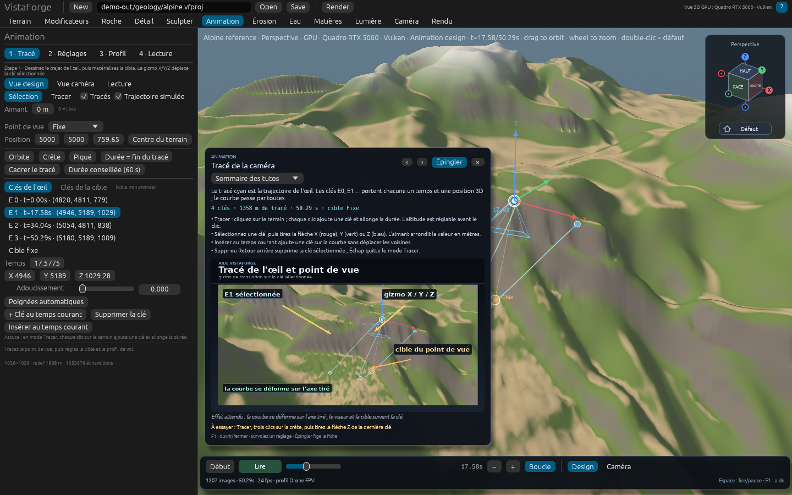

# Aide contextuelle et tutoriels

> Une fiche d'aide s'ouvre dans le viewport quand la souris survole un espace,
> un panneau, une section ou un réglage. Chaque fiche contient un résumé, les
> paramètres qui changent vraiment le résultat, une capture annotée de l'effet
> attendu et, pour certains sujets, des valeurs live.



## Utiliser l'aide

- **Survol** : passez la souris sur un onglet de la barre du haut, un onglet
  d'Animation, un titre de section ou n'importe quel réglage à l'intérieur.
  La fiche la plus précise gagne (un réglage dans « Optique et caméra » ouvre
  la fiche Optique, pas la fiche générale de l'onglet).
- **`F1`** ou le bouton **`?`** de la barre d'outils : ouvre ou ferme la fiche
  de l'espace courant.
- **Épingler** : garde la fiche affichée quand la souris quitte les réglages.
- **Sommaire des tutos** : liste les 25 fiches, regroupées par thème.
- **`‹` / `›`** : fiche précédente / suivante.
- **`×`** ou **Échap** : ferme la fiche.
- La carte est ancrée en bas à gauche du viewport ; en Animation elle est
  remontée au-dessus de la barre de lecture. Elle ne bloque jamais les clics
  du tracé : le viewport sait qu'elle est au premier plan.

## Couverture

| Thème | Fiches |
|---|---|
| Prise en main | Espaces de travail, navigation/gizmo, barre de lecture |
| Animation | Tracé, cible, durée/cadence, optique, contraintes, profil de vol, lecture, export |
| Terrain et scène | Génération, monde/tuilage, modificateurs, roche, détail, sculpteur, érosion, eau, matières, lumière, caméra de conception |
| Rendu | Rendu final CPU, aperçu adaptatif, viewport GPU |

Les fiches documentent volontairement les paramètres **significatifs et peu
courants** (par exemple la liaison ressort, l'évitement de parois, le patch de
gros plan, le mode seamless, l'étagement neige/arbres), pas chaque slider.

## Visuels

Les images sont dans [`docs/help/`](help/). Elles sont embarquées dans le
binaire avec `include_bytes!` et chargées à la demande.

- `path.png`, `target.png`, `profile.png` : captures réelles du viewport avec
  annotations.
- `workspace.png`, `gizmo.png`, `camera.png`, `transport.png`, `timing.png`,
  `optics.png`, `constraints.png` : schémas annotés ou composites.
- `terrain.png`, `world.png`, `modifiers.png`, `rock.png`, `detail.png`,
  `sculpt.png`, `erosion.png`, `water.png`, `materials.png`, `light.png`,
  `render.png` : rendus de démonstration avant/après ou galeries, annotés.

Toutes les images font 960×540 (16:9) pour rester lisibles dans la carte.

## Fabriquer ou mettre à jour les visuels

Deux scripts déterministes :

```bash
# 1. Schémas et composites à partir des rendus de démo
python3 scripts/make_help_images.py

# 2. Captures réelles de l'application (écrase path/target/profile)
VISTAFORGE_CAPTURE=/tmp/vf-captures \
  cargo run -p vf-app -- demo-out/geology/alpine.vfproj
VISTAFORGE_CAPTURES=/tmp/vf-captures \
VISTAFORGE_VIEWPORT=360,100,1270,810 \
  python3 scripts/make_help_screenshots.py
```

`VISTAFORGE_VIEWPORT` recadre le viewport dans la capture ; la valeur
`360,100,1270,810` correspond au rendu GPU utilisé pour les visuels livrés.
Le mode capture (`VISTAFORGE_CAPTURE`) parcourt un plan intégré : Animation
(tracé, aide, cible, profil, transport, réglages) puis chaque espace de travail.
Il attend la fin de l'aperçu, demande une capture à eframe et ferme la
fenêtre. Pour un rendu CPU `glow`, retirez `VISTAFORGE_VIEWPORT` (le cadrage
par défaut vise alors le viewport CPU). Les captures sont écrites dans le dossier demandé.

Variables utiles pour une capture isolée :

```bash
VISTAFORGE_WORKSPACE=Animation   # Terrain, Modifiers, Rock, Detail, Sculpt,
                                 # Animation, Erosion, Water, Materials,
                                 # Light, Camera, Render
VISTAFORGE_ANIM_TAB=Timing       # Path, Timing, Profile, Preview
VISTAFORGE_HELP_TOPIC=Profile    # ouvre et épingle une fiche au démarrage
```

## Ajouter une fiche

1. Ajouter une variante à `HelpTopic` et à `HelpTopic::ALL` dans
   `crates/vf-ui/src/help.rs`.
2. Renseigner `title`, `section`, `summary`, `bullets`, `image`, `caption` et,
   si utile, `try_it` et `live_line`.
3. Ajouter l'image à `HelpImage` et à `bytes()`.
4. Enregistrer le sujet sur un contrôle :
   - les titres de section passent par le `CollapsingResponse` et couvrent tout
     le corps de la section ;
   - les contrôles hors section utilisent le fallback de panneau
     (`register_front`) ou un `help.register(rect, topic)` explicite.
5. Lancer `cargo test -p vf-ui help::tests` : les tests vérifient que chaque
   fiche a un résumé, au moins trois puces, un visuel 960×540 valide, et que le
   nom est reconnu par `VISTAFORGE_HELP_TOPIC`.

## Limites

- L'aide suit le survol de la souris ; il n'y a pas encore de visite guidée
  automatique pas-à-pas qui déplace la caméra ou applique un réglage.
- Les fiches sont en français, comme le reste de l'interface.
- Une capture réelle dépend du projet et du cadrage au moment du build ; les
  scripts gardent donc des schémas de secours pour les sujets purement
  explicatifs.
