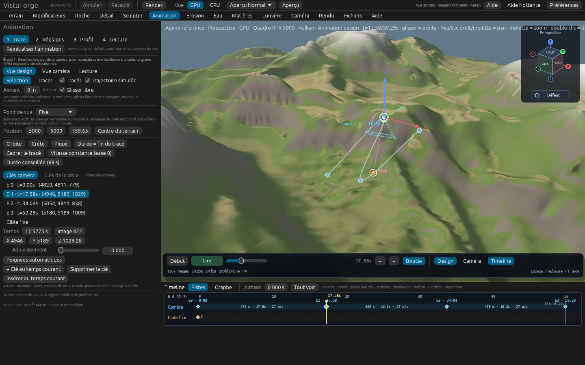
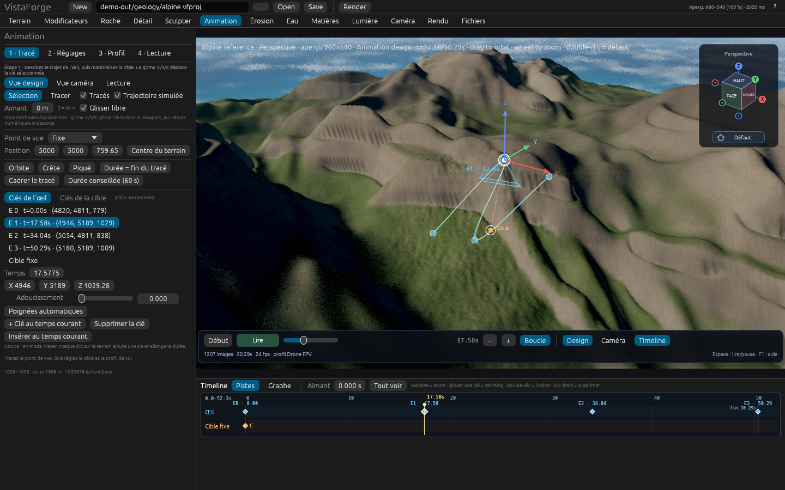
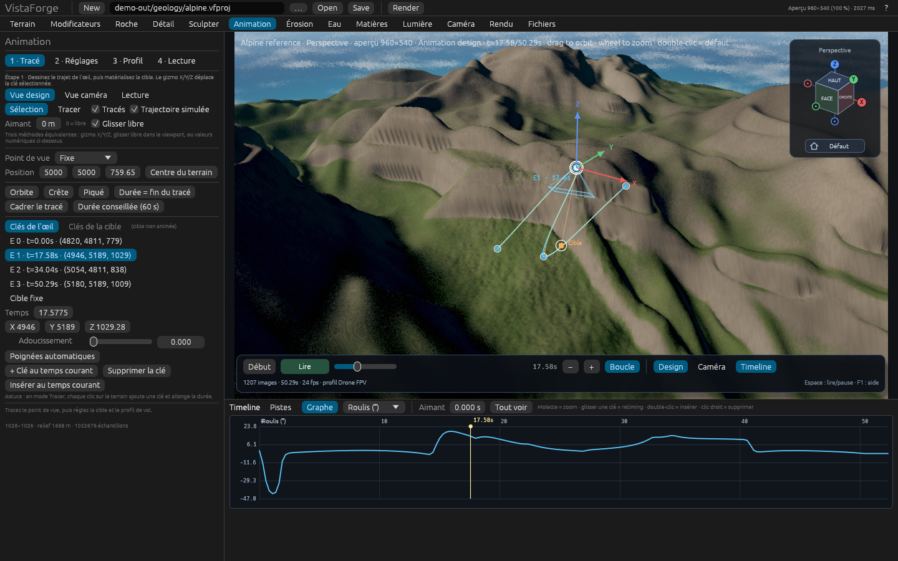
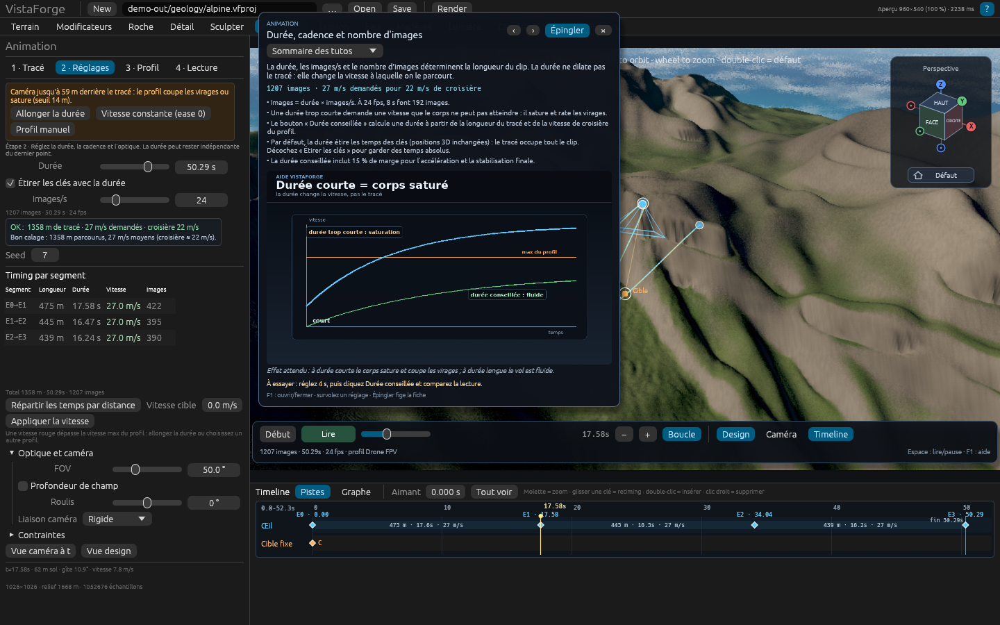

# Animation de caméra

> Un seul espace **Animation** remplace les anciens onglets **Vol** et
> **Animation**. Ce document décrit le parcours utilisateur, les interactions
> du viewport, les profils de vol et l'export.



## Parcours en quatre étapes

L'espace Animation est découpé en quatre onglets numérotés. Le viewport et sa
barre de lecture restent visibles dans tous les onglets.

1. **Tracé** — dessiner et éditer le chemin de la caméra et la cible.
2. **Réglages** — durée, cadence, optique, contraintes.
   Le bouton **Réinitialiser l'animation**, sous les onglets, remet le rig par
   défaut sans toucher à la caméra de vue ; Ctrl+Z restaure l'ancienne
   animation.
3. **Profil** — choisir le corps et comparer les dynamiques.
4. **Lecture** — jouer l'animation, rendre une image ou exporter la séquence.

Le bouton de lecture n'est plus caché dans un panneau : une **barre de
transport** est ancrée en bas du viewport. `Lire`, `Pause`, `Début`, curseur de
temps, image précédente/suivante, boucle, bascule **Design / Caméra** et
**Timeline** y sont toujours accessibles. `Espace` produit le même effet que
`Lire`. La lecture se fait dans la vue courante : en design, le frustum et les
marqueurs s'animent sans quitter l'orbite ; en caméra, le cadre rendu défile.

## 1. Tracé

Le tracé cyan est la trajectoire de la caméra. Les clés `E0`, `E1`… portent chacune
un temps et une position 3D. La cible orange matérialise le point regardé ; elle
n'est dessinée qu'en **vue design**, jamais dans le rendu.

### Dessiner

- Activez **Tracer** : chaque clic sur le terrain ajoute une clé à la fin du
  tracé et allonge la durée.
- L'altitude de la clé est réglée avant le clic (`+ 80 m` par défaut) ; un
  aperçu du point d'impact, de la verticale et de l'altitude suit la souris.
- **Ajouter Œil / Cible** choisit le chemin alimenté par le clic.
- **Échap** quitte le mode Tracer.

### Éditer

- Trois méthodes équivalentes : le gizmo, le **glisser libre** dans le viewport,
  ou les champs numériques X/Y/Z de la clé sélectionnée.
- Tirez la flèche **X** (rouge), **Y** (vert) ou **Z** (bleu) du gizmo. Le
  déplacement se fait dans le plan de l'écran le long de l'axe.
- **Adoucissement** d'une clé : 0 = vitesse constante, 1 = ralentit à la clé.
  Les nouvelles clés sont à 0 ; le bouton **Vitesse constante (ease 0)** remet
  tout le tracé à zéro.
- **Glisser libre** (coché par défaut) : cliquez-glissez directement sur une clé
  pour la déplacer dans le plan de l'écran, sans viser un axe. `Maj` la contraint
  à la verticale, `Alt` la pose sur le terrain sous le curseur.
- L'aimant arrondit les coordonnées en mètres (`0` = libre).
- **Insérer au temps courant** ajoute une clé sur la courbe sans déplacer les
  voisines ; **Suppr** ou **Retour arrière** supprime la clé sélectionnée.
- **Poignées automatiques** remet les poignées de la clé à zéro ; la courbe est
  alors lissée par ses voisines.
- **Cadrer le tracé** replace la caméra de conception sur le chemin ; le pivot d'orbite devient le centre du tracé, pas celui du terrain.
- Faire tourner la caméra de conception, zoomer ou recadrer n'altère jamais le
  tracé ; on revient à la vue caméra avec `Caméra`.

### Timeline et graph editor





Le dock **Timeline** (bouton dans la barre de transport) reste visible dans les
quatre onglets.

- **Pistes** : deux lignes, Caméra et Cible, avec un losange par clé. Cliquer-glisser
  un losange change son **temps** ; double-cliquer sur une piste insère une clé à
  cet instant ; clic droit supprime la clé.
- **Graphe** : choisissez un canal (`Caméra X/Y/Z`, `Cible X/Y/Z`, `Vitesse`,
  `Roulis`). Les positions se lisent sur la courbe Bézier réelle ; vitesse et
  roulis viennent de la simulation du profil actif. Sur un canal de position,
  glisser un point change à la fois son temps et sa valeur.
- Molette = zoom temporel, **Tout voir** recadre, `Aimant` arrondit les temps
  (et les valeurs en mode graphe).
- Les clés situées au-delà de la fin restent affichées après le repère `fin` :
  elles ne sont simplement pas jouées.

Le graph editor est le lien direct entre les réglages de profil et l'animation :
changez de profil, la courbe de roulis se met à jour sans retoucher le tracé.

### Point de vue

La cible est optionnelle :

| Mode | Comportement |
|---|---|
| **Aucune cible** | Plus de point cible, plus de clés cible : la caméra regarde devant elle le long de sa trajectoire. Le keyframing ne porte que sur la caméra. |
| **Fixe** | Un point immobile, utile pour un plan large ou une orbite. |
| **Tracé animé** | Une seconde courbe indépendante avec ses clés `T0`, `T1`… C'est le keyframing différencié caméra/cible. |
| **Avance sur courbe** | La cible est **exactement sur la courbe de la caméra** échantillonnée à `t + avance`. Une avance négative regarde en arrière sur la même courbe. Rien n'est extrapolé hors du tracé. |
| **Décalage** | Liaison rigide : la cible reste à un offset monde constant de la caméra (X/Y/Z). |
| **Retard sur courbe** | La cible vise la caméra telle qu'elle était il y a N secondes, sur la même courbe. |
| **Manuel** | La caméra suit son axe, sans point cible matérialisé. |

Le viewport de conception dessine le **viseur** du point de vue (tronc de
frustum depuis la caméra vers la cible) et la ligne caméra → cible. Le rendu utilise
exactement la caméra échantillonnée à `t`, sans ces overlays. L'overlay utilise
désormais le même calcul de cible que la simulation (offset inclus).

Pour un tracé cible, deux boutons créent un lien éditable :
**Copier le tracé de la caméra** (même courbe, offset nul) et **Copier + décalage**
(même courbe, offset monde). **Synchroniser les temps** copie les temps des
clés de la caméra sur celles de la cible.

## 2. Réglages

- **Durée** (0,1–600 s), **images/s** (1–120), **nombre d'images**.
- **Optique** : FOV, profondeur de champ, ouverture, mise au point, roulis,
  liaison caméra rigide ou ressort.
- **Altitude relative au sol (AGL)** : la hauteur Z des clés devient une
  hauteur **au-dessus du relief** au lieu d'une altitude absolue. La
  trajectoire horizontale et le timing ne changent pas. Réglages :
  - **Amortissement caméra** et **amortissement cible** (temps de réponse en
    secondes) : lissent le suivi du relief, indépendamment pour les deux ;
  - **Anticipation relief** : regarde le sol devant la caméra pour commencer à
    monter avant la pente ;
  - **Empreinte au sol** : rayon sur lequel on prend le point haut, pour
    ignorer les facettes et les pics d'une cellule ;
  - **Plancher AGL** : hauteur minimale dure, appliquée aussi en suivi exact.
- **Contraintes** : garde au sol amortie, hauteur, sol de référence, évitement
  des parois, distance/marge/angle/anticipation/détour, douceur, application au
  trajet caméra et à la caméra optique. Ces corrections s'appliquent **aussi en
  suivi exact**.

Un encadré de calage compare **vitesse demandée** et **vitesse de croisière**
du profil (75 % de sa vitesse maximale). Si la durée est trop courte, le corps
sature et prend du retard ; le bouton **Ajuster la durée** applique la durée
conseillée calculée depuis la longueur du tracé. Une durée plus longue ne
déplace aucune clé : elle change seulement la vitesse de parcours.

La **durée pilote la vitesse de parcours**. Par défaut, la case **Étirer les
clés avec la durée** est cochée : changer la durée rééchelonne les temps des
clés (les positions 3D ne bougent pas) pour que le tracé occupe tout le clip.
Une durée plus courte accélère donc réellement le survol, une durée plus longue
le ralentit — sans que la caméra atteigne la fin puis attende.

Décochez la case pour garder des temps de clés absolus : la durée peut alors
être indépendante du dernier point, les clés au-delà de la fin restent
conservées mais ne sont pas jouées. Un encadré signale l'écart et propose
**Étendre à la dernière clé** ou **Étirer les clés sur la durée**. Le curseur de
durée est logarithmique, avec un champ numérique fin et un double-clic pour
revenir à 8 s.

La durée conseillée inclut désormais une marge de confort de 15 % pour
l'accélération, les virages et la stabilisation finale.

## 3. Profil de vol

Le profil ne change pas le tracé ; il change la façon dont le corps le suit.

| Preset | Caractère |
|---|---|
| **Drone FPV** | Nerveux, accélérations franches, virages serrés, forte inclinaison. |
| **Oiseau** | Souple et flottant, réactions moyennes, turbulences. |
| **Hélicoptère** | Posé et lourd, accélérations douces, faible roulis, nacelle stable. |
| **Ballon dirigeable** | Très inertiel, grandes courbes, roulis presque nul. |
| **Avion de chasse** | Ultra rapide, réponses immédiates, virages violents. |
| **Manuel** | Suit exactement le tracé, sans inertie ; exclu des comparaisons. |

Chaque preset ajuste aussi l'optique et la garde au sol (FOV, ouverture,
clearance), ce qui aide à ressentir le véhicule.

- Les **courbes** comparent vitesse et roulis des six corps sur le tracé
  courant. Manuel est exclu de l'échelle.
- **Comparer les trajectoires** superpose les cinq corps dans le viewport ; le
  corps actif est en jaune, les autres gardent leur couleur.
- **Tracé de démonstration (S)** crée un S dont la taille et la durée sont
  adaptées au profil (90 % de sa vitesse max) et cadre la caméra dessus. C'est
  le moyen le plus rapide de voir la différence entre un drone et un
  hélicoptère en quelques secondes.
- **Tester ce profil** lance la lecture dans la vue courante (design ou caméra).

Le rig utilise un ressort critique avec **avance de vitesse** : l'accélération
demandée est bornée par axe, puis le jerk est limité. Sans cette avance, le
ressort se battait contre la vitesse du tracé et, une fois la borne
d'accélération atteinte, les corps rapides oscillaient autour de la courbe au
lieu de la suivre.

## 4. Lecture et export

- Curseur de temps : place l'animation à l'instant choisi.
- `Lire` / `Pause`, boucle, vitesse de lecture (0,05–4×). La lecture est
  **design** par défaut : l'orbite ne bouge pas, le frustum et les marqueurs
  avancent. `Caméra` bascule sur le cadre rendu.
- **Vue design** : tracé, cible, viseur et gizmo.
- **Vue caméra** : le cadre réel ; orbiter ou zoomer depuis cette vue repasse
  automatiquement en design.
- **Image à ce temps (CPU)** : rendu final d'une frame.
- **Séquence PNG** : `frame_00000.png`, `frame_00001.png`… dans le dossier
  choisi, avec progression et annulation. La résolution et la qualité viennent
  du panneau **Rendu**. Un export de 1200 images en pleine résolution peut être
  long ; commencez par 320×180 en qualité Low.

L'encodeur MP4 reste disponible en CLI :

```bash
vistaforge anim render scene.vfproj frames/ --video clip.mp4
```

### Trajectoire seule, sans géométrie

Un survol se réutilise dans un autre projet ou dans Blender sans exporter le
terrain :

```bash
vistaforge rig export scene.vfproj survol.glb     # caméra + cible animées
vistaforge rig export scene.vfproj survol.vfcam   # rig complet, JSON
vistaforge rig export scene.vfproj survol.csv     # une ligne par image
vistaforge rig import autre_terrain.vfproj survol.vfcam --out rejoue.vfproj
```

Le GLB s'importe dans Blender avec `File > Import > glTF 2.0` ou, mieux, avec
l'addon `bridge/blender/vistaforge_io.py` qui sélectionne la caméra, remplace la
caméra statique et règle `fps`/plage d'images. L'addon sait aussi réexporter la
caméra et l'empty cible vers `.vfcam` pour revenir dans VistaForge. Détails :
[`FICHIERS.md`](FICHIERS.md).

### Suivi exact et vitesse

Deux modes de suivi coexistent :

- **Suivre exactement le tracé (sans inertie)**, coché par défaut : la caméra
  est exactement sur la courbe aux temps des clés. La distance parcourue est
  proportionnelle au temps (échantillonnage par **longueur d'arc** dans chaque
  segment), donc `vitesse = distance / durée` et `images = durée × fps` sont
  cohérents. Le profil continue de piloter le roulis, les secousses et la visée.
- **Inertie du profil** (case décochée) : le ressort, la traînée et l'évitement
  peuvent faire couper les virages. C'est le mode des comparaisons de profils.

L'échantillonnage par longueur d'arc est le correctif de fond : un Bezier
paramétré linéairement en `u` avance vite au milieu du segment et lentement près
des clés, même avec `ease = 0`. Avec l'inversion de longueur d'arc, un segment
de 475 m sur 17,58 s se parcourt bien à 27 m/s moyens, et la clé est atteinte à
son temps.

### Timing par segment et vitesse



L'onglet **Réglages** affiche un tableau par segment `E0→E1`, `E1→E2`… :

| Segment | Longueur | Durée | Vitesse | Images |
|---|---|---|---|---|
| E0→E1 | 312 m | 6,20 s | 50,3 m/s | 149 |

La longueur est mesurée sur la **courbe réelle** (handles automatiques et ease
compris), pas sur la distance entre clés. Une vitesse supérieure à la vitesse
max du profil est affichée en rouge.

Trois actions :

- **Répartir les temps par distance** : à durée totale constante, chaque
  segment reçoit une durée proportionnelle à sa longueur. Les vitesses
  moyennes deviennent égales.
- **Vitesse cible** : saisissez une vitesse (0 = croisière du profil) puis
  **Appliquer la vitesse**. Les temps sont recalculés et la durée du clip est
  mise à jour en conséquence.
- **Synchroniser les temps cible** : recopie les temps de la caméra sur la cible.

Dans la **Timeline**, chaque segment est dessiné comme une barre avec
`longueur · durée · vitesse` ; les segments trop rapides passent en orange.
Cliquer-glisser un losange change le temps de la clé, double-cliquer insère une
clé, le clic droit supprime. Le panneau de la clé sélectionnée permet de saisir
son temps en **secondes ou en images**.

### Suivi du tracé

En mode **inertie** uniquement, un profil de vol n'est pas une interpolation :
il a une vitesse maximale, des accélérations bornées et de la traînée. Si la
durée est trop courte, la caméra coupe les virages et reste derrière la courbe.
L'interface mesure cet écart et affiche un bandeau dans l'espace Animation :

> Caméra jusqu'à 60 m derrière le tracé…

Trois corrections en un clic :

- **Allonger la durée** (durée conseillée, avec marge) ;
- **Vitesse constante (ease 0)** : supprime le ralentissement/accélération à
  chaque clé. Les nouvelles clés utilisent déjà `ease = 0` ; les anciennes
  peuvent être remises à zéro ;
- **Profil manuel** : suit exactement le tracé, sans inertie.

Même en inertie, le simulateur démarre à la vitesse du tracé et compense la
traînée par une avance de poussée. En suivi exact, ces écarts n'existent plus :
la caméra est sur la courbe et la vitesse est celle des clés.

### Lissage de visée et parois

- Les modes **Avance**, **Décalage**, **Retard** et **Manuel** appliquent un
  filtre du premier ordre sur la cible (`lissage visée` + `look_lag` du corps +
  60 ms). En suivi exact, la visée est verrouillée et ce lissage est ignoré.
- **Garde au sol** : plancher anticipé sur l'empreinte du terrain, correction
  verticale amortie et plancher dur. Actif même en suivi exact ; ne jamais
  s'écraser quand la case est cochée.
- **Évitement de parois** : détection dans une fenêtre d'anticipation, montée
  si l'accélération verticale du profil le permet, sinon **détour latéral**
  (angle d'impact ±20°, côté choisi par sonde), puis retour vers le tracé. Un
  garde-fou final empêche toute traversée et signale `paroi bloquée` si le
  couloir est trop étroit. Le roulis est calculé depuis le mouvement réel filtré
  et limité à 120°/s.

## CLI

```bash
# État du rig
vistaforge rig info scene.vfproj

# Preset de profil (sans toucher au tracé)
vistaforge rig preset scene.vfproj helicopter

# Clé de tracé
vistaforge rig key scene.vfproj --time 4 --x 3200 --y 5100 --z 900

# Une image et une séquence avec le rig du projet
vistaforge anim still scene.vfproj frame.png --time 2
vistaforge anim render scene.vfproj frames/ --fps 24
```

## Limites connues

- Les poignées Bézier manuelles ne sont pas encore éditables dans le viewport ;
  le bouton **Poignées automatiques** remet la clé sélectionnée à zéro et laisse
  la courbe lissée par ses voisines.
- L'évitement de parois teste la hauteur du sommet du mur le plus proche : un
  survol au-dessus du plateau n'est plus poussé latéralement. Il reste un champ
  2D, donc une arche ou un surplomb n'est pas modélisé.
- Les poignées Bézier restent éditables numériquement (ease et handles) mais pas
  par un graphe de poignées dédié ; la timeline édite les temps et les valeurs.
- Le DOF est calculé par le rig et appliqué par Blender/Cycles ; le rasteriseur
  CPU ne le rasterise pas.

## Captures

Les captures de cette page proviennent du mode capture :

```bash
VISTAFORGE_CAPTURE=/tmp/vf-captures \
  cargo run -p vf-app -- demo-out/geology/alpine.vfproj

VISTAFORGE_CAPTURES=/tmp/vf-captures \
VISTAFORGE_VIEWPORT=360,100,1270,810 \
  python3 scripts/make_help_screenshots.py
```

Voir [`AIDE.md`](AIDE.md) pour la fabrication des fiches.
