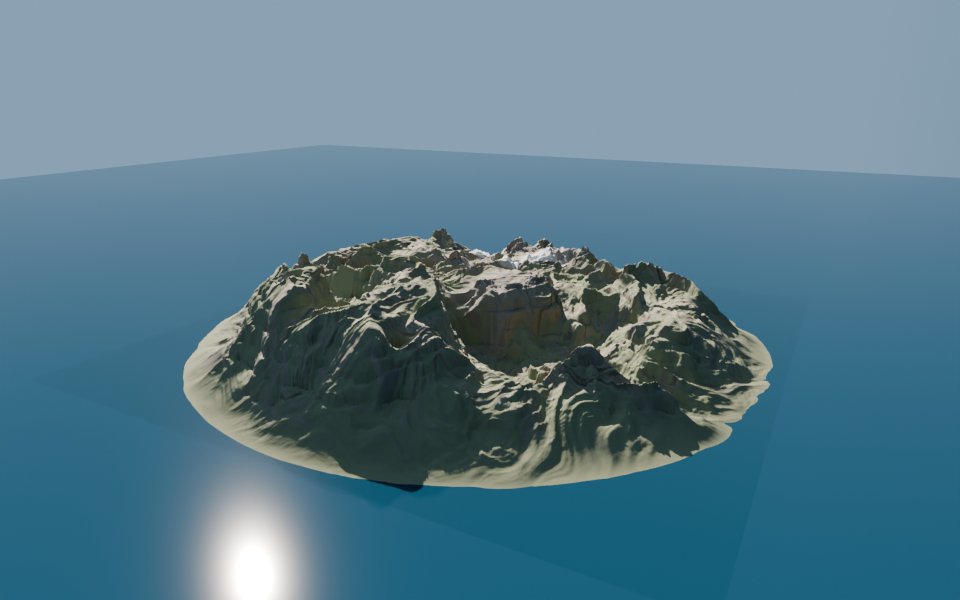

# Bridge Blender

VistaForge exporte la scène **telle que le rasteriseur la voit** — modificateurs,
pass de falaises et détail continu compris — vers un GLB, des textures cuites
et un script d'import Blender. Le but est de continuer le texturing dans
Blender sans reconstruire la géométrie ni deviner les matériaux.



---

## 1. Commandes

```bash
# Export seul : écrit scene.glb, scene.json, textures et un README
cargo run --release -p vf-cli -- blender export ile.vfproj demo-out/blender/ile \
  --subdivision 2

# Export + import + rendu Cycles headless
cargo run --release -p vf-cli -- blender render ile.vfproj demo-out/blender/ile.png \
  --samples 64 --width 1600 --height 900

# GPU (OptiX/CUDA si disponible)
cargo run --release -p vf-cli -- blender render ile.vfproj demo-out/blender/ile_gpu.png \
  --samples 128 --gpu

# Import dans une session Blender interactive :
# Scripting > Open > bridge/blender/vistaforge_import.py, puis renseigner glb et json.

# Trajectoire seule (caméra + cible, sans géométrie)
cargo run --release -p vf-cli -- rig export ile.vfproj demo-out/blender/ile/camera_animation.glb
```

Options utiles : `--no-water`, `--no-camera`, `--no-sun` à l'export ;
`--script`, `--blender`, `--out-dir` au rendu. Le script accepte aussi
`--validate` (import sans rendu), `--smart-uv`, `--remesh` et
`--save-blend`.

---

## 2. Contenu du dossier d'export

| Fichier | Contenu |
|---|---|
| `scene.glb` | maillage réel (détail continu, matière et déplacement inclus), normales, UV0 plan et UV1 métrique, couleurs de sommets, 7 emplacements de matériaux, caméra, soleil. |
| `scene.obj` | même surface en Wavefront OBJ. Si l'option **quads** du menu Détail est active, les faces sont des quads/n-gons (glTF reste triangulé). |
| `scene.json` | palette, soleil, caméra, unités, CRS, stats du terrain, réglages de rendu, roche, détail, correspondance des matériaux. |
| `albedo.png` | albédo cuit en UV0 (sRGB), à remplacer par les textures de l'artiste. |
| `normal.png` | normale dérivée du heightfield détaillé (UV0, espace top-down). |
| `masks.png` | R = neige, G = végétation, B = éboulis, pour mélanger des textures. |
| `heightmap_16.png` | heightfield de la surface exportée, 16 bits, **ligne 0 = nord, blanc = haut** (convention UV0). |
| `README.txt` | rappel de la commande d'import. |
| `camera_animation.glb` | optionnel : trajectoire caméra/cible exportée par l'espace Fichiers ou `rig export`. |

### Coordonnées

VistaForge travaille en **Z-up, mètres**. glTF est **Y-up** ; l'export applique
`(x, y, z) -> (x, z, -y)`. La caméra regarde son -Z local, le soleil voyage
selon son -Z local. Les unités restent métriques dans Blender.

### Matériaux

Sept emplacements sont écrits :

| Matériau | Rôle |
|---|---|
| `vf_rock` | roche de fond, la plupart des faces. |
| `vf_strata_a`, `vf_strata_b` | bancs stratifiés (si la géologie est active). |
| `vf_scree` | éboulis. |
| `vf_snow` | neige. |
| `vf_vegetation` | végétation basse. |
| `vf_water` | plan de mer. |

Le script Blender branche `albedo.png` sur la couleur de base, `normal.png`
sur la normale, et ajoute un bruit procédural de secours. Il expose aussi
`masks.png` dans le graphe de nœuds : l'artiste peut remplacer l'albédo par
ses propres textures par matériau et utiliser les masques pour les mélanges.

### UV

- **UV0** : projection planaire du terrain (une seule charte). C'est celle qui
  reçoit les textures cuites.
- **UV1** : **atlas de boîte** à six projections (3×2 cellules), pour les
  falaises et les surplombs. Les arêtes entre deux projections peuvent être
  recousues dans Blender (Merge by Distance) ou remplacées par `--smart-uv`.
- Le GLB importe bien **deux couches UV** (vérifié : `2 UV layer(s)`).

### Maillage adaptatif et quads

Le menu **Détail** propose **Adapter localement le maillage à la forme** et une
**tolérance géométrique** en mètres. Le niveau suit l'**écart au plan local**
(angle des faces / courbure) : une pente raide mais lisse reste grossière, une
crête pointue est subdivisée. Le déplacement de matière est inclus dans la
fonction de hauteur de la **seconde passe** ; les raccords 2:1 sont cousus sans
trous et les UV restent la projection monde, donc la texture ne se casse pas
aux transitions.

Le même panneau propose **Exporter en quads / n-gons**. Le GLB reste triangulé
(le format glTF ne connaît pas les quads), mais `scene.obj` conserve les faces
à quatre côtés ou plus : c'est le fichier à importer dans Blender pour
sélectionner les boucles, déplier et peindre confortablement. Les deux fichiers
partagent les mêmes UV0.

`--smart-uv` recalcule une projection dans Blender, au prix de la
correspondance avec `albedo.png` et `normal.png`. `--remesh` applique un
modifier Voxel Remesh destructif ; à réserver aux objets lourds ou aux tests.
`--save-blend` écrit un `.blend` configuré avant le rendu.

### Matières et textures

Le menu **Matières** applique un preset de roche procédurale (granite, basalte,
calcaire, grès, schiste, craie, volcanique), un bump et un déplacement. Une
texture personnelle (PNG/JPEG/TIFF) peut être peinte dans le panneau, ou
importée par chemin : sa luminance sert au bump et au déplacement. L'export
Blender cuit les mêmes couleurs dans `albedo.png` et applique le déplacement
au maillage, donc le rendu Cycles part du même état que l'aperçu CPU.

---

## 3. Pipeline exporté

```
heightfield stocké
  → pile de modificateurs (si active)
  → pass falaises (cliff_warp inclus)
  → champ de détail continu (profil de roche)
  → maillage subdivisé (1–8×) ou adaptatif à la forme
  → déplacement de matière (procédural + texture perso)
  → couleurs de sommets + classes de matériaux
  → GLB + OBJ + textures cuites + sidecar
```

C'est le même ordre que le rendu CPU. Un modificateur ou un réglage de falaise
qui n'apparaît pas dans Blender est un bug.

---

## 4. Validation

Validé sur cette machine avec **Blender 5.3** :

```text
VistaForge import: 1 mesh object(s), 1054733 vertices, 2 material(s), camera=True
VistaForge render written to docs/screenshots/blender_cycles.png
```

Le rendu Cycles 960×600, 24 échantillons, CPU, prend ~13 s (import compris).
Le GPU n'est pas activé par défaut car une session headless n'a pas toujours
de périphérique OptiX configuré ; `--gpu` tente OptiX et retombe sur CPU.

---

## 5. Trajectoires caméra / cible (aller-retour)

Le bridge ne se limite plus au maillage : une trajectoire peut être échangée
sans terrain.

```bash
# VistaForge -> Blender
vistaforge rig export scene.vfproj survol.glb
vistaforge rig export scene.vfproj survol.vfcam

# Blender -> VistaForge (depuis l'addon, ou un .vfcam écrit à la main)
vistaforge rig import autre_terrain.vfproj survol.vfcam --out rejoue.vfproj
```

### Addon Blender

`bridge/blender/vistaforge_io.py` s'installe comme add-on
(`Edit > Preferences > Add-ons > Install`) et ajoute :

- `File > Import > VistaForge Camera Animation (.glb)` : importe la caméra
  `VistaForge Camera`, l'empty `VistaForge Target`, remplace une caméra
  statique du même nom, règle `fps`, `frame_start/frame_end` depuis le rig et
  sélectionne la caméra.
- `File > Export > VistaForge Camera Animation (.vfcam)` : échantillonne la
  caméra active et l'empty cible (ou le -Z de la caméra à 500 m) et écrit un
  `.vfcam` relisible par VistaForge.

Le GLB contient aussi le rig complet dans `scenes[0].extras.vistaforge_rig` :
le retour VistaForge est donc **sans perte**. Sans ces extras, l'import
reconstruit le chemin de l'œil depuis les translations et la visée depuis les
rotations de la caméra (ou depuis l'empty cible s'il est animé).

Validation Blender 5.3 :

```text
GLB 8 s / 24 fps -> action 0..192, caméra et cible mobiles
addon export .vfcam -> 193 clés
vistaforge rig import -> 193 clés, target Path, durée 8 s
```

### Scène + trajectoire

1. `vistaforge blender export scene.vfproj blender-out --subdivision 2`.
2. `vistaforge rig export scene.vfproj blender-out/camera_animation.glb`.
3. Dans Blender : importer `scene.glb`, puis
   `File > Import > VistaForge Camera Animation (.glb)`.
4. L'addon remplace la caméra statique, conserve le terrain, les matériaux et
   le soleil, et règle la plage d'images.

Le bouton **Exporter pour Blender (GLB)** de l'espace Fichiers écrit les deux
fichiers dans le même dossier.

## 6. Limites de la version 1

- Le round-trip **géométrie** reste aller seulement ; le round-trip
  **trajectoire** est assuré par `.vfcam`/GLB et l'addon.
- Pas d'arbres/rochers instanciés ni de végétation géométrique.
- `albedo.png` et `normal.png` sont des textures de départ, pas des baking
  PBR multi-UDIM ; le script Smart UV/remesh est là pour les cas difficiles.
- L'atlas UV1 est par sommet : les triangles qui changent d'axe peuvent
  étirer une couture. Smart UV reste la solution propre pour un asset final.
- Les surplombs maillés (P1.5) ne sont pas encore exportés comme objets
  séparés ; `undercut` est cuit dans le heightfield.
- Le plan d'eau est un rectangle ; pas de rivière ni de lac vectoriel.
