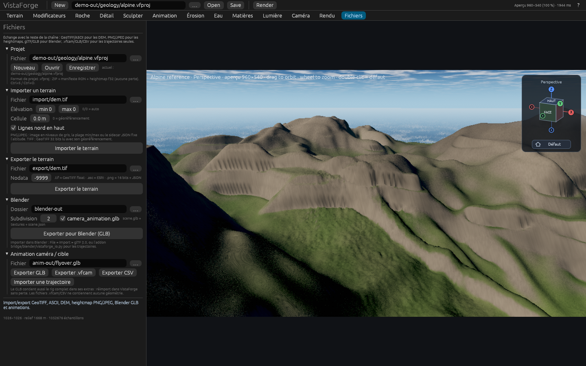

# Fichiers, DEM, heightmaps et Blender

VistaForge échange avec le reste de la chaîne sans format propriétaire obligatoire.
Le projet `.vfproj` reste le format de travail (aucune perte), mais le terrain,
les heightmaps et les trajectoires peuvent sortir et revenir dans des formats
ouverts et documentés.



## 1. Choisir le bon format

| Besoin | Format recommandé | Notes |
|---|---|---|
| Sauvegarder un projet complet | `.vfproj` | ZIP + manifeste RON + heightmap f32 + aperçu PNG. Aucune perte. |
| DEM géoréférencé, QGIS/GDAL/Blender GIS | **GeoTIFF 32 bits float** | Écrit avec `ModelPixelScale`, `ModelTiepoint`, CRS projeté utilisateur en mètres et `GDAL_NODATA`. |
| DEM texte, interopérabilité maximale | **ESRI ASCII Grid** (`.asc`) | En-tête `ncols/nrows/xllcorner/yllcorner/cellsize`. |
| Heightmap pour moteur de jeu / sculpt | **PNG 16 bits** | Un sidecar `.json` et un world file `.pgw` conservent altitude, échelle et origine. |
| Aperçu rapide ou échange informel | JPEG | **Lossy** : jamais pour un DEM de travail. |
| Ancien format VistaForge | `.dem` v1 | i16, palette, session opaque. Import et export toujours disponibles. |
| Échange brut / moteur | `.r32` + `.json` | f32 little-endian, ligne 0 au sud ; le sidecar porte dimensions, pas et origine. |
| Blender, scène complète | **GLB + OBJ** | Maillage, 7 matériaux, UV0/UV1, caméra, soleil, textures cuites. `scene.obj` conserve les quads/n-gons du maillage adaptatif, le GLB reste triangulé. |
| Blender, trajectoire seule | **GLB caméra** ou `.vfcam` | Aucune géométrie ; voir §5. |
| Tableur / pipeline custom | CSV | Une ligne par image : temps, œil, cible, up, roulis, FOV, vitesse. |

## 2. Espace **Fichiers** de l'interface

L'onglet `Fichiers` regroupe :

- **Projet** : nouveau, ouvrir, enregistrer. Le bouton `…` ouvre un navigateur
  de fichiers intégré (pas de dépendance native) ; `Ctrl+O` / `Ctrl+S` font la
  même chose.
- **Importer un terrain** : chemin, plage d'altitude, cellule, sens des lignes.
- **Exporter le terrain** : GeoTIFF, ASCII, DEM, PNG 16 bits ou JPEG selon
  l'extension du chemin.
- **Blender** : dossier de sortie, subdivision, case `camera_animation.glb`.
- **Animation caméra / cible** : export GLB, `.vfcam`, CSV et import d'une
  trajectoire sans toucher au terrain.

Le CLI expose les mêmes opérations ; c'est pratique pour les scripts et la CI.

## 3. Heightmaps PNG / TIFF / JPEG

### Import

```bash
# PNG 8 bits : la plage 120..900 m remplace le 0..255 de l'image
vistaforge terrain import relief.png --out relief.vfproj \
  --min-height 120 --max-height 900 --spacing 25

# PNG 16 bits exporté par VistaForge : le sidecar JSON fournit la plage
vistaforge terrain import heightmap_16.png --out relief.vfproj

# GeoTIFF : le géoréférencement (cellule + origine) est lu dans le fichier
vistaforge terrain import dem.tif --out dem.vfproj
```

Règles :

- **PNG/TIFF 8/16 bits** : les valeurs sont normalisées 0..1. La plage
  `--min-height/--max-height` (ou le sidecar) donne l'altitude réelle.
  `0/0` signifie « automatique » : sidecar s'il existe, sinon 0..1000 m.
- **JPEG** : accepté, mais la compression introduit des marches dans le relief.
- **TIFF 32 bits float** (GeoTIFF) : les valeurs sont déjà en mètres, le
  géoréférencement est conservé, et `--spacing` peut le remplacer.
- Les lignes des images sont **nord en haut** ; VistaForge stocke la ligne 0 au
  sud. L'import retourne l'image par défaut (`--no-flip-y` pour désactiver).
- Les dimensions jusqu'à 16 384² sont acceptées ; au-delà de 4 096², pensez à
  densifier ou à découper.

### Export

```bash
vistaforge terrain export scene.vfproj dem.tif          # GeoTIFF float
vistaforge terrain export scene.vfproj dem.asc          # ESRI ASCII
vistaforge terrain export scene.vfproj heightmap.png    # PNG 16 + JSON + PGW
vistaforge terrain export scene.vfproj apercu.jpg       # JPEG 8 bits
vistaforge terrain export scene.vfproj ancien.dem       # DEM v1 (i16)
```

Le PNG 16 bits est normalisé entre le minimum et le maximum du terrain. Le
sidecar (`heightmap.json`) et le world file (`heightmap.pgw`) contiennent :

```json
{
  "format": "vistaforge.heightmap.v1",
  "width": 2050,
  "height": 2050,
  "min_height": -12.4,
  "max_height": 1278.2,
  "spacing_x": 4.880429,
  "spacing_y": 4.880429,
  "origin_x": 0.0,
  "origin_y": 0.0,
  "nodata": -9999.0,
  "bit_depth": 16
}
```

Sans sidecar, un PNG reste importable : fournissez simplement la plage
d'altitude. Le round-trip 16 bits a une erreur de quantification inférieure à
`plage / 65535` (quelques centimètres sur un relief de 1 000 m).

## 4. DEM et GeoTIFF

Le GeoTIFF écrit par VistaForge est un raster simple bande `float32`, compressé
sans perte, lisible par QGIS, GDAL, Blender GIS, CloudCompare, etc.

- `ModelPixelScale` : taille de cellule X/Y en mètres.
- `ModelTiepoint` : coin nord-ouest.
- `GeoKeyDirectory` : type projeté, unité mètre, pixel-is-point.
- `GDAL_NODATA` : valeur nodata optionnelle (`-9999` par défaut dans l'UI).

L'import lit aussi les GeoTIFF entiers (u8/u16/i16/i32/f32/f64), les bandes
multi-canal (converties en luminance) et applique le masque nodata.

```bash
# Vérifier un GeoTIFF exporté
gdalinfo dem.tif        # si GDAL est installé
vistaforge terrain info dem.vfproj
```

## 5. Trajectoires caméra / cible vers Blender (et retour)

Trois formats, sans aucune géométrie :

| Fichier | Contenu | Retour VistaForge |
|---|---|---|
| `.vfcam` | JSON lisible : `CameraRig` complet (clés, poignées, cible, optique, profil, contraintes) + référence de terrain légère | **Oui, sans perte** |
| `.glb` | glTF 2.0 : caméra perspective + empty cible + animations translation/rotation. Le rig complet est aussi dans `scenes[0].extras.vistaforge_rig` | **Oui, sans perte** si les extras sont présents ; sinon reconstruction depuis les pistes caméra |
| `.csv` | Une ligne par image (`time_s,eye_*,target_*,up_*,roll,fov,speed`) | Oui (approximation linéaire entre images) |

```bash
# Exporter la trajectoire seule
vistaforge rig export scene.vfproj survol.glb
vistaforge rig export scene.vfproj survol.vfcam
vistaforge rig export scene.vfproj survol.csv

# Réimporter sans toucher au terrain
vistaforge rig import autre_terrain.vfproj survol.vfcam --out rejoue.vfproj
```

### Blender : deux méthodes

**A. glTF standard, sans addon.** `File > Import > glTF 2.0`, choisir
`survol.glb`. Blender importe `VistaForge Camera`, `VistaForge Target` et
l'action `VistaForge Camera and Target`. Il reste à sélectionner la caméra et à
régler la plage d'images ; l'addon le fait automatiquement.

**B. Addon VistaForge (recommandé).**
Installer `bridge/blender/vistaforge_io.py` via
`Edit > Preferences > Add-ons > Install`, puis activer
**VistaForge Camera Animation**. Menu :

- `File > Import > VistaForge Camera Animation (.glb)` : importe, sélectionne
  la caméra, remplace une caméra statique du même nom, règle `fps`,
  `frame_start/frame_end` depuis le rig et laisse la cible animée.
- `File > Export > VistaForge Camera Animation (.vfcam)` : échantillonne la
  caméra active et l'empty cible sélectionné, écrit un `.vfcam` relisible par
  `vistaforge rig import`.

Validation effectuée sur Blender 5.3 :

```text
GLB VistaForge 8 s / 24 fps
→ objets : VistaForge Camera (CAMERA), VistaForge Target (EMPTY)
→ action : VistaForge Camera and Target, frames 0..192
→ positions caméra et cible différentes à t=0, 2 s, 4 s, 8 s
→ export .vfcam 193 images
→ vistaforge rig import : 193 clés, target Path
```

### Scène complète + trajectoire

```bash
# 1. Scène (maillage + textures + caméra statique + soleil)
vistaforge blender export scene.vfproj blender-out --subdivision 2

# 2. Trajectoire seule
vistaforge rig export scene.vfproj blender-out/camera_animation.glb
```

Dans Blender : importer `scene.glb` (script `vistaforge_import.py` ou glTF),
puis `File > Import > VistaForge Camera Animation (.glb)`. L'addon remplace la
caméra statique par la caméra animée et conserve le terrain, les matériaux et
le soleil. Le bouton **Exporter pour Blender (GLB)** de l'espace Fichiers écrit
les deux fichiers d'un coup.

## 6. Limites connues

- Le JPEG est lossy : ne l'utilisez pas comme DEM de travail.
- Le GeoTIFF utilise un CRS **utilisateur** en mètres : renseignez le CRS réel
  dans QGIS/GDAL si le DEM doit être superposé à des données géographiques.
- Les textures Blender restent un point de départ (albédo/normale/masques), pas
  un baking PBR multi-UDIM.
- Le `.vfcam` ne transporte pas la géométrie. Si la trajectoire vient d'un
  autre terrain, elle est conservée telle quelle : c'est à l'utilisateur de
  vérifier l'échelle et l'origine.
- L'addon Blender importe les animations de caméra/empty, pas les courbes
  Bézier VistaForge comme poignées éditables : il les échantillonne image par
  image. Le `.vfcam`, lui, conserve les poignées et l'ease d'origine.

## 7. Maillages 3D : `.vfm`, OBJ, STL, GLB

Le module **Maillage 3D** ajoute quatre sorties, indépendantes du `.vfproj` :

| Extension | Contenu | Usage |
| --- | --- | --- |
| `.vfm` | Format natif binaire : positions, normales, UV, couleurs RGBA (alpha = masque), topologie n-gon (`corners`/`starts`), slots de matériau, métadonnées (nom, roche, qualité, graine, note). | Sauvegarde d'atelier, rechargement exact. |
| `.obj` | N-gons, normales, UV. | Blender, Maya, ZBrush. |
| `.stl` | Triangles, normales plates. | Impression 3D, slicer. |
| `.glb` | Triangles, couleurs, un primitive par matériau. | Blender, moteurs temps réel. |

Le `.vfm` commence par la signature `VFM1`, un numéro de version (`u32`, actuellement
`1`), puis les tableaux. Les limites de sécurité sont 32 M de sommets et 128 M de
coins. Un fichier corrompu est refusé avec une erreur explicite, jamais chargé
partiellement.

```powershell
vistaforge mesh --project demo/canyon.vfproj --out demo/sculpture.vfm
vistaforge mesh --project demo/canyon.vfproj --out demo/sculpture.obj
vistaforge mesh --project demo/canyon.vfproj --out demo/sculpture.stl
vistaforge mesh --project demo/canyon.vfproj --out demo/sculpture.glb
```

L'interface expose les mêmes boutons dans **Maillage 3D > Vue et export**.

