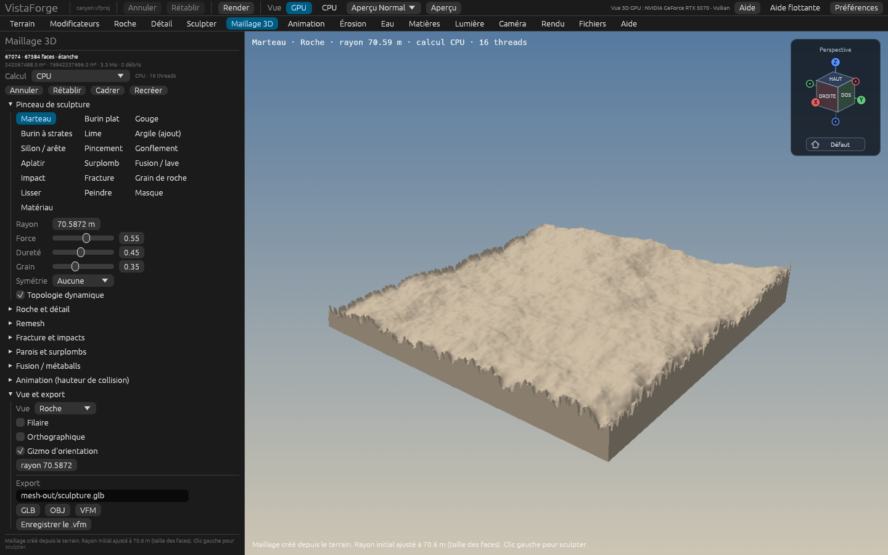
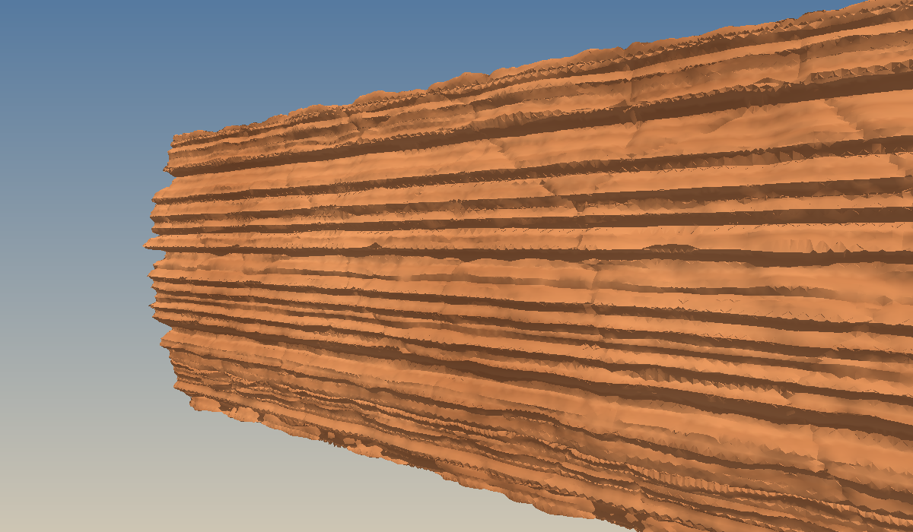
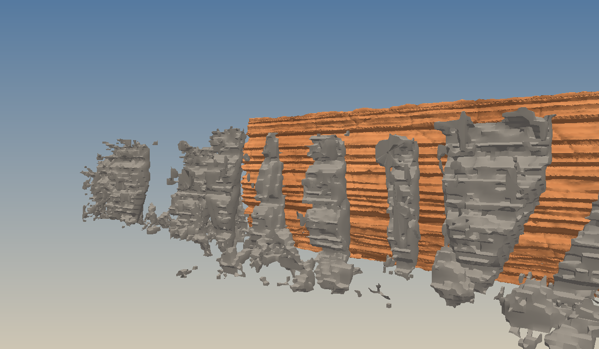
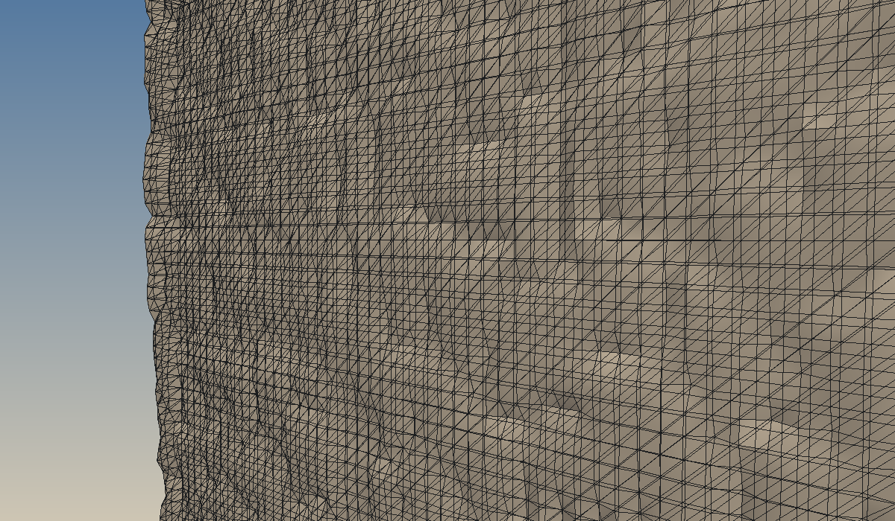

# Maillage 3D — sculpture, fracture et parois

Le module **Maillage 3D** prolonge le terrain heightmap par un vrai maillage
polygonal éditable. Le heightfield reste la source du paysage ; le maillage permet
tout ce qu'une grille d'altitude ne peut pas représenter : surplombs, gouffres,
fractures traversantes, impacts, coulées de lave, blocs qui tombent et s'empilent.

> Le maillage ne revient **pas** modifier le heightfield. En revanche, l'animation
> continue de fonctionner dans les deux modules : un maillage peut exposer une
> hauteur de référence (`terrain::animation_heightfield`) pour la caméra, et les
> débris sont simulés avec la même physique déterministe.



## Démarrage rapide
1. Ouvrir un projet, puis l'onglet **Maillage 3D**.
2. Le maillage est créé automatiquement depuis le terrain à la première visite
   (256 cellules sur le côté long, dalle fermée sous le point le plus bas). Le
   rayon du pinceau est ajusté à la taille des faces pour que le premier clic
   soit visible.
3. **Clic gauche** : sculpter. **Clic droit** ou **Maj + clic gauche** : orbite.
   **Molette** : zoom. Le curseur montre la zone d'effet et la normale de contact (voir
   ci-dessous).
4. Le **gizmo d'orientation** en haut à droite recadre la vue (face, axe, maison).
5. Le panneau gauche contient les outils, la roche, le remesh, la fracture, les
   parois et l'export.

Le rendu du viewport est un rasteriseur CPU multi-thread (z-buffer, filaire réel,
modes Roche / Peinture / Normales / Masque / Matériaux / Profondeur / Occlusion).
Il est volontairement séparé du rendu final pour rester interactif pendant
l'édition.

## Outils de sculpture

Dix-neuf outils, tous sensibles au rayon, à la force, à la dureté, au grain et à la
symétrie (X, Y, X+Y, radiale) :

| Outil | Ce qu'il fait |
| --- | --- |
| **Marteau** | Enlève de la matière par facettes, avec un grain rocheux. |
| **Burin plat / Gouge / Burin à strates** | Creuse des rainures orientées ; le burin à strates suit les bancs. |
| **Sillon / arête / Pincement** | Ajoute une crête ou pince la surface. |
| **Lime** | Arase les aspérités et les arêtes. |
| **Argile (ajout)** | Empâte de la matière, pour les formes rondes. |
| **Aplatir / Lisser / Remplir** | Nivelle localement, adoucit ou comble un creux. |
| **Surplomb** | Pousse la surface vers l'extérieur, y compris au-dessus du vide. |
| **Fusion / lave** | Fond la matière et la fait couler le long de la pente. |
| **Impact** | Cratère avec rebord et éjecta. |
| **Fracture** | Réseau de fissures (voir ci-dessous). |
| **Grain de roche** | Ajoute le micro-relief d'un type de roche. |
| **Peindre / Masque / Matériau** | Couleur, protection de la zone, slot de matériau. |

Le canal alpha de la couleur de sommet est le **masque de sculpture** : 0 protège
la zone, 255 la laisse libre. Les outils ignorent les sommets masqués, sauf
l'outil Masque lui-même.

La **topologie dynamique** subdivise localement sous le pinceau (jusqu'à un nombre
de subdivisions réglable) pour que le détail reste fin même sur un maillage de
base grossier.

### Curseur, normale et rayon effectif

Le curseur est dessiné en espace écran, donc il reste net et suit la souris sans
relancer le rendu du maillage :

- **croix blanche** : point de contact exact ;
- **disque orange translucide + anneau** : zone d'effet attendue ; les huit
  graduations marquent le bord ;
- **anneau blanc fin** : rayon demandé, quand il diffère du rayon effectif ;
- **aiguille cyan** : moyenne des normales lissées des trois sommets de la face
  de contact (et non la normale plate du triangle) ; quand cette normale pointe
  vers l'écran, elle est représentée par le symbole point-dans-un-cercle ;
- **étiquette** : `N moy.`, rayon effectif, taille des faces et écart avec la
  normale géométrique.

Un pinceau plus petit qu'une arête du maillage ne toucherait aucun sommet : le
rayon est alors **élargi automatiquement** à la taille de la face de contact, et
le panneau affiche « Zone réelle … : le rayon est plus petit qu'une arête ».
Augmentez le rayon ou la résolution (remesh) pour sculpter plus fin.

### Gizmo d'orientation

Même triade CAO que le viewport du terrain, en haut à droite de la vue :

- le **cube** suit la caméra d'orbite du maillage ; ses faces visibles sont
  cliquables ;
- les **axes X/Y/Z** et leurs extrémités négatives recadrent la sculpture sur
  cette direction ;
- la **maison** revient à la vue d'ensemble (yaw 38°, pitch 24°) ;
- le clic sur le gizmo ne sculpte pas : le pinceau est neutralisé tant que la
  souris est sur le cube, et un trait déjà commencé continue sans s'interrompre ;
- la case **Vue et export → Gizmo d'orientation** le masque.

L'orbite manuelle reste disponible (clic droit, Maj + clic gauche, molette) ; le
gizmo et l'orbite écrivent les mêmes angles yaw/pitch, donc la vue ne saute pas
après un clic sur une face.

### Réactivité

Pendant une orbite ou un trait, l'aperçu utilise un maillage de rendu allégé et
72 % de la résolution ; la qualité complète revient 350 ms après le relâchement.
Le rapport topologique (volume, étanchéité, composantes) n'est recalculé qu'à la
fin d'un trait ou après une opération de topologie, pas à chaque image. Pour les
gros maillages, utilisez le binaire **release**
(`dist/windows-x86_64/vistaforge-app.exe`) : le binaire `debug` est plusieurs
fois plus lent.

### Budget de calcul (CPU / GPU)

Le module 3D partage son pool de threads avec le reste de VistaForge et peut en
plus déporter ses transformations géométriques sur le GPU. Ouvrez
**Préférences → Calcul (CPU / GPU)**, ou le sélecteur **Calcul** en tête du
panneau du module :

- **Moteur des transformations géométriques** : `CPU`, `GPU (un adaptateur)` ou
  `GPU (tous les adaptateurs)`. Il couvre les normales, le lissage de Taubin, le
  déplacement du détail rocheux, les transformations et la sculpture. Le
  changement est immédiat (le sélecteur du panneau suffit), enregistré dans
  `compute.ron`, et le libellé **Moteur actif** indique l'adaptateur retenu ou
  la raison du repli CPU.
  - Les noyaux partent sur le GPU au-delà de ~2 048 sommets : en dessous, le
    transfert coûte plus que le calcul et le CPU est utilisé.
  - En mode **tous les adaptateurs**, la plage de sommets est découpée entre les
    GPU cochés, chacun dans son thread, puis réassemblée dans l'ordre. Un
    portable à double GPU peut donc utiliser l'intégré et le discret ensemble.
  - Un adaptateur qui ne s'ouvre pas (pilote, mémoire, shader) fait basculer
    l'opération sur le CPU sans erreur visible : la ligne **Dernier repli CPU**
    des préférences donne le message exact.
- **Cœurs de calcul** : automatique (tous les cœurs logiques) ou de 1 à N.
  Le pool est reconstruit immédiatement ; les opérations suivantes
  (construction du BVH, maillage de rendu, remesh, fracture, voxel/SDF,
  métaballs, aperçus, export) utilisent le nouveau budget sans redémarrer.
- **Aperçu 3D wgpu** : la case et l'adaptateur de l'aperçu concernent le
  viewport du terrain et s'appliquent au prochain lancement ; le rendu final et
  les calculs de relief restent sur le CPU, qui est le chemin déterministe.
- Les variables `VISTAFORGE_THREADS`, `VISTAFORGE_COMPUTE`
  (`cpu`/`gpu`/`all`), `VISTAFORGE_COMPUTE_GPU` et `VISTAFORGE_GPU`
  (`auto`, `off` ou nom d'adaptateur) permettent de régler les mêmes valeurs
  depuis un script. La CLI expose `--threads`, `--compute` et `--compute-gpu`.

Le nombre de cœurs et le moteur ne changent jamais le résultat d'une opération :
les algorithmes parallèles écrivent chacun dans leur région ou réduisent dans un
ordre fixe, l'érosion hydraulique découpe ses gouttes en lots fixes avant de
sommer les deltas, et le chemin GPU applique les mêmes formules (octet final
près, les pilotes pouvant fusionner des multiplications-additions).

> **Quel moteur choisir ?** Sur un poste récent, le pool CPU reste le plus
> rapide : chaque appel GPU transfère la topologie complète par le bus. Le GPU
> devient intéressant quand on limite volontairement les cœurs (par exemple 4
> pour laisser respirer l'interface), sur une machine à peu de cœurs, ou pour
> libérer le CPU pendant une opération longue. Les mesures détaillées sont dans
> [`GPU.md`](GPU.md#cpu-ou-gpu--ce-que-disent-les-mesures).

## Remesh

Quatre modes, avec un budget de faces qui borne toujours le résultat :

- **Triangles** : remesh isotrope (division des arêtes longues, effondrements,
  bascules, lissage de Taubin), puis projection sur la surface de référence.
- **Quads** : le même remesh, puis appariement des triangles coplanaires en quads.
  Le résultat s'exporte tel quel en OBJ/GLB et se subdivise proprement dans Blender.
- **Voxel** : conversion en champ de distance signé, `surface nets`, lissage de
  Taubin. C'est le mode qui referme les auto-intersections et fabrique un volume
  étanche pour la fracture ou l'impression 3D.
- **Raffiner** : densifie seulement les zones courbes, sans changer la topologie
  globale.

La longueur d'arête demandée est automatiquement relevée si elle impliquerait
des centaines de millions de faces : `surface / max_faces` donne une arête
plancher. Le panneau affiche les faces avant/après et le temps.

## Fracture, impacts et physique

`fracture::FractureSettings` propose cinq motifs : **Voronoi**, **radial**,
**en couches**, **colonnaire** et **cisaillement**. La fracture est calculée dans
un champ SDF : chaque cellule de Voronoï est polygonisée séparément, avec un
`gap_m` qui écarte les morceaux. Chaque morceau est un maillage fermé avec son
volume, son centroïde et ses bornes.

Les morceaux peuvent être :

- ajoutés comme **débris** et simulés par `physics::PhysicsWorld` (gravité,
  restitution, frottement, amortissements, contact avec le maillage, sommeil) ;
- fusionnés au maillage après la chute (`Fusionner les débris`) ;
- exportés séparément ou avec la scène.

La simulation est **déterministe** : même graine, même ordre d'insertion, même tas
final, quel que soit le nombre de threads.

`impact_crater` et `stamp` (outil Impact) produisent un cratère avec rebord ;
`fuse_blob`, `fuse_field` et `fuse_path` créent des coulées de lave ou des ponts
de matière entre deux surfaces. Les **metaballs** (`MetaField`, `blend_meshes`)
donnent un effet blob entre maillages, avec un rayon d'influence et un `smooth_k`.
Dans l'interface, **Fusion / métaballs** place un blob au point cliqué et le fond
dans la surface avec un raccord réglable.

## Parois rocheuses

Cinq presets inspirés des photos de référence (falaise littorale stratifiée,
carrière d'ardoise, paroi de schiste, orgues basaltiques, canyon de grès) :

- longueur, hauteur, courbure, pendage ;
- bancs (épaisseur, profondeur, dureté alternée) ;
- joints verticaux et colonnes ;
- surplombs réels (`overhang_m`), encoches et replats ;
- bruit multi-échelle et grain.

`cliff::wall` construit une paroi **fermée** (face avant déplacée, face arrière,
bas, haut, extrémités), donc elle peut être fracturée, voxelisée ou imprimée.
`stack_wall` empile plusieurs bancs, `carve_wall` passe un pinceau le long d'un
chemin, `notch` et `overhang_bands` ajoutent des accidents locaux.



La même paroi après fracture de Voronoï et simulation des débris :



Le mode filaire montre la topologie réelle, y compris les quads du remesh :



## Roche et détail

Neuf profils : granite, basalte, calcaire, grès, schiste, craie, volcanique,
canyon, Patagonie. Chaque profil règle l'épaisseur des bancs, les joints,
l'exfoliation, les vésicules, les tafoni, les oolithes, les replats et le grain.

`rock::apply_detail` déplace les sommets le long de la normale avec ces couches ;
`adaptive_detail` subdivise d'abord les zones mal résolues, puis applique le
profil. `tint_by_profile` donne une couleur cohérente (les strates plus sombres,
les creux plus froids), et `RockStats` recommande une arête cible.

## Qualité et mémoire

Les presets de qualité fixent le voxel et le budget :

| Niveau | Voxel | Budget voxels | Usage |
| --- | --- | --- | --- |
| Aperçu | 0,80 m | 2 M | navigation, brouillon |
| Équilibré | 0,45 m | 16 M | édition courante |
| Haute | 0,28 m | 64 M | fracture, détail |
| Ultra | 0,16 m | 256 M | gros plans, export |
| Personnalisé | réglable | réglable | machine atypique |

`QualityLevel::fit(available_mb)` choisit le niveau qui tient dans la RAM
disponible. Le panneau `SculptStats` affiche sommets, faces, mémoire, composants,
étanchéité, aire et volume.

## Export et Blender

| Format | Ce qui est conservé |
| --- | --- |
| `.glb` | Triangles, normales, UV0/UV1, couleurs RGBA, un primitive par slot de matériau. |
| `.obj` | N-gons (quads inclus), normales, UV. |
| `.vfm` | Format natif : topologie n-gon, couleurs, masque, matériaux, métadonnées. |
| `.stl` | Triangles, pour l'impression 3D. |

Le `.glb` est produit par `vf_export::scene_from_sculpt` : les arêtes vives sont
dupliquées selon l'angle de lissage (35°), les couleurs sont linéarisées et les
slots deviennent des primitives séparées. Il s'importe directement dans Blender
(`File > Import > glTF 2.0`), avec les couleurs de sommets.

L'export `.vfm` est relu par `io::read_vfm` et conserve exactement la topologie,
y compris les quads et les n-gons.

## CLI

```powershell
# Maillage depuis le terrain, remesh quads, export GLB + aperçu
vistaforge mesh --project demo/canyon.vfproj --resolution 160 `
  --remesh quads --edge 0.8 --rock sandstone `
  --out demo/canyon.glb --render demo/canyon.png

# Paroi de grès avec détail, fracture et physique
vistaforge mesh --project demo/canyon.vfproj --source wall `
  --wall sandstone-canyon --rock canyon --fracture voronoi --cell 4 --physics `
  --out demo/wall-fractured.glb --render demo/wall-fractured.png
```

Options utiles : `--source terrain|wall`, `--wall sea-cliff|slate-quarry|schist-wall|basalt-columns|sandstone-canyon`,
`--remesh triangles|quads|voxel`, `--max-faces`, `--fracture voronoi|radial|layered|columnar|shear`,
`--rock <profil>`, `--wireframe`, `--width/--height`.

## Animation dans le module 3D

Le maillage ne remplace pas le heightfield pour l'animation, mais il fournit une
hauteur de référence :

- dans **Maillage 3D > Animation (hauteur de collision)**, le bouton
  **Hauteur depuis le maillage** rééchantillonne le dessus du maillage sculpté sur
  la grille du projet et l'utilise pour la caméra, les presets de vol et les
  exports d'animation ; **Revenir au terrain** rétablit le DEM ;
- `terrain::to_heightfield(mesh, …)` fait la conversion explicitement ;
- `terrain::animation_heightfield(mesh, reference)` construit le heightfield de
  collision pour la caméra et les objets volants ;
- `physics::PhysicsWorld::settle(Some((&mesh, &bvh)), dt)` fait atterrir les
  débris sur la géométrie réelle, surplombs compris.

On peut donc dessiner un vol dans l'atelier Animation, puis le rejouer au-dessus
d'une paroi fracturée : la caméra utilise la hauteur du maillage, pas celle du DEM
d'origine.

## Déterminisme et tests

Le bruit (Perlin, Voronoï, strates) est maison et basé sur `hash_u64` ; aucun
`HashMap` n'ordonne une réduction parallèle. Les tests couvrent math, bruit,
maillage, BVH, voxel, remesh, sculpture, fracture, metaballs, physique, roche,
parois, terrain, document, rendu et formats de fichier (80 tests).

```powershell
cargo test -p vf-sculpt
cargo clippy -p vf-sculpt --all-targets -- -D warnings
```

## Limites connues

- Le maillage n'est pas encore exposé comme outils MCP ; le CLI et l'UI le sont.
- Le viewport CPU n'a pas d'ombres projetées ; le rendu final heightfield garde
  son pipeline complet.
- Le remesh quads reste coûteux au-delà de ~300 000 faces ; utiliser le budget
  de faces ou le mode Voxel pour les gros volumes.
- La fracture voxelise le volume : prévoir de la RAM pour les très gros blocs
  (qualité Haute/Ultra).
