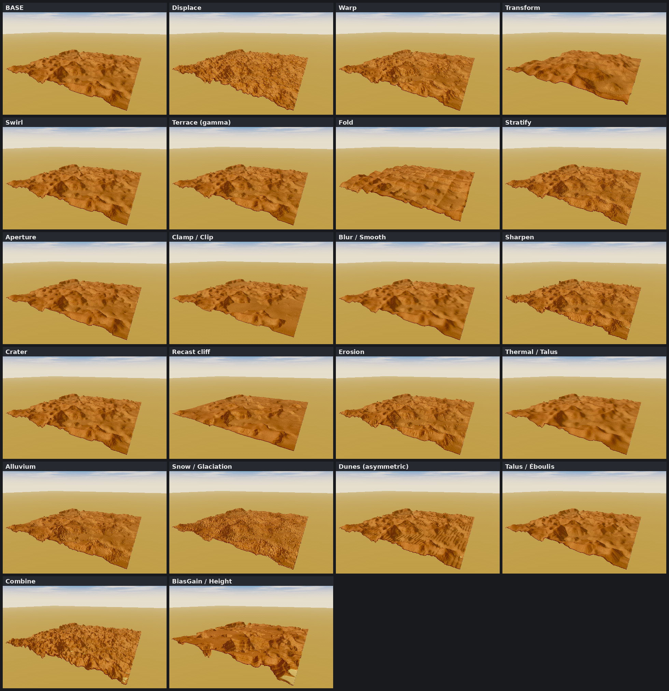

# Les modificateurs de terrain

> 27 opérateurs déterministes, utilisables au CLI, dans l'interface de bureau
> et via le serveur MCP. Ils s'appliquent **au rendu**, dans l'ordre de la pile,
> sans toucher au heightfield enregistré tant qu'on ne les « cuit » pas.

---

## 1. Principe

Le terrain de base est produit par le pipeline habituel :

```
source fractale → érosion → géologie → stabilisation → micro-détail
```

La pile de modificateurs s'applique **après** ce pipeline, au moment du rendu.
Chaque opérateur reçoit le heightfield courant et renvoie un nouveau champ,
avec le même maillage, le même masque et la même origine. Les rendus, les
aperçus, les séquences de vol et les exports passent tous par la même pile :
un modificateur ne peut pas « marcher » dans un outil et pas dans un autre.

Le heightfield stocké dans le `.vfproj` reste le terrain de base. Cela permet :

- de réordonner ou de désactiver un modificateur sans regénérer le fractal ;
- d'appliquer la pile à un DEM importé (le DEM n'est pas réécrit) ;
- de rendre deux variantes du même projet sans dupliquer le terrain.

`terrain modifier bake` applique la pile au heightfield stocké puis vide la
pile. Après un bake, le résultat est figé (et les modificateurs ne sont plus
rejoués au rendu).

### Déterminisme

Tous les opérateurs sont déterministes. Le bruit et les placements de cratères
sont dérivés de `seed.derive("modifier-<index>-<kind>")`. Réordonner la pile
change les seeds, donc le résultat ; c'est volontaire.

### Résolution

Les distances sont en mètres et converties en cellules via le spacing du
heightfield. Un rayon de 60 m vaut 12 cellules à 5 m/cellule et 2 cellules à
30 m/cellule. Les opérateurs qui le nécessitent élargissent leur noyau ou
bornent leur fenêtre.

---

## 2. Les opérateurs

### 2.1 Déformation et déplacement

| Kind | Libellé | Ce qu'il fait |
|---|---|---|
| `displace` | Displace | Déplacement vertical par bruit fBm ou ridged, anisotrope (angle). Brise la symétrie et ajoute du micro-relief. |
| `warp` | Warp | Déplacement horizontal dans le plan, piloté par deux bruits ; `slope_bias` concentre la déformation sur les pentes. |
| `transform` | Transform | Translation, rotation, échelle (et répétition) du relief autour du centre. |
| `swirl` | Swirl | Torsion circulaire dans un rayon, avec atténuation : cratères vrillés, formations tourbillonnantes. |

### 2.2 Sculpture géologique

| Kind | Libellé | Ce qu'il fait |
|---|---|---|
| `terrace` | Terrace | Paliers horizontaux. Profil gamma par banc + variation aléatoire par banc (technique HighMap `strata_terrace`) pour éviter l'escalier mécanique. |
| `fold` | Fold | Compression par repliement de domaine le long d'un axe : plis tectoniques, crêtes acérées. |
| `stratify` | Stratify | Strates inclinées et bandes d'érosion différentielle, surtout sur les faces raides. |
| `aperture` | Aperture | Dilate (amount > 0) ou contracte (amount < 0) les formes par filtre max/min séparable. |
| `clamp` | Clamp / Clip | Coupe les altitudes min/max, avec adoucissement optionnel. |
| `blur` | Blur / Smooth | Gaussienne séparable ; adoucit les angles et les massifs anciens. |
| `sharpen` | Sharpen | Unsharp mask : accentue les arêtes et le contraste des crêtes. |
| `crater` | Crater | Cratères d'impact avec cuvette et bourrelet périphérique, placés de façon déterministe. |
| `recast_cliff` | Recast cliff | Recalcification par amplification de gradient et résolution de Poisson (HighMap `recast_cliff`) : parois raides et lisses, sans paliers. Coûteux. |

### 2.3 Détail de roche

Ces six opérateurs cuisent dans le heightfield le relief qui, sinon, resterait
dans le champ de détail continu (`vf-detail`). Ils sont utiles pour un export
DEM, pour nourrir l'érosion, ou pour graver une variante dans un projet.

| Kind | Libellé | Paramètres principaux | Ce qu'il fait |
|---|---|---|---|
| `grooves` | Sillons | `spacing_m`, `depth_m`, `angle_deg`, `sharpness`, `wander`, `slope_only` | Cannelures directionnelles qui sinuent, concentrées sur les faces. |
| `ridges` | Arêtes | `scale_m`, `amplitude_m`, `sharpness`, `anisotropy`, `angle_deg` | Crêtes acérées anisotropes, pour les quartzites et les crêtes de granite. |
| `crater_field` | Champ de cratères | `density`, `spacing_m`, `radius_m`, `depth_m`, `rim`, `ejecta` | Cratères déterministes avec bourrelet et éjecta, distribution irrégulière. |
| `exfoliate` | Exfoliation | `scale_m`, `amplitude_m`, `sharpness`, `layers` | Feuillets courbes empilés, signature des granites et des grès. |
| `vesicles` | Vésicules | `spacing_m`, `depth_m`, `density` | Puits arrondis de la lave et des scories. |
| `undercut` | Surplomb / corniche | `depth_m`, `band_m`, `height_m`, `spacing_m`, `angle_deg`, `sharpness` | Niche creusée sous un banc dur, avec contreforts. C'est une **approximation heightfield** : le vrai surplomb maillé est prévu au lot P1.5. |

`slope_only` vaut 0 sur les replats et 1 sur les faces ; les opérateurs
s'élargissent à au moins deux cellules pour rester lisibles aux basses
résolutions. `undercut` ne modifie que les pentes fortes.

### 2.3 Érosion naturelle

| Kind | Libellé | Ce qu'il fait |
|---|---|---|
| `erosion` | Erosion | Gouttes hydrauliques : ravines, réseaux, dépôt en bas de pente. |
| `thermal` | Thermal / Talus | Relaxation thermique : effritement, talus limite. Ne construit pas de cône. |
| `alluvium` | Alluvium | Deux passes hydrauliques + lissage des fonds : dépôts alluvionnaires et cônes. |
| `snow` | Snow / Glaciation | Accumulation dans les creux (amount > 0) ou creusement glaciaire + élargissement des vallées (amount < 0). |
| `dunes` | Dunes / Sand | Ondulations asymétriques : versant au vent doux, crête, versant sous le vent raide (HighMap `wave_dune`). |
| `talus` | Talus / Éboulis | Remplissage par angle de repos : construit l'éboulis géométrique au pied des falaises (HighMap `fill_talus`). |

### 2.4 Combinaison

| Kind | Libellé | Ce qu'il fait |
|---|---|---|
| `combine` | Combine | Fusionne avec un champ procédural : add, subtract, max, min, embed. |
| `bias_gain` | BiasGain / Height | Modifie la distribution des hauteurs (biais, gain, pivot). |

### Paramètres

Chaque opérateur expose ses paramètres par un nom stable (`amount_m`,
`scale_m`, `talus_deg`…). Les plages et valeurs par défaut sont dans
`vf-core/src/modifiers.rs` et sont interrogées par le CLI (`--json`), l'UI
(sliders générés) et le MCP (`modifiers.kinds`). Exemple :

```bash
vistaforge terrain modifier add scene.vfproj recast_cliff \
  --param talus_deg=40 --param amplitude=1.5 --param gain=5 \
  --param radius_m=40 --param iterations=400
```

---

## 3. CLI

```bash
# Lister la pile (texte ou JSON avec plages et valeurs)
vistaforge terrain modifier list scene.vfproj
vistaforge terrain modifier list scene.vfproj --json

# Ajouter un modificateur et régler ses paramètres
vistaforge terrain modifier add scene.vfproj terrace \
  --param step_m=120 --param strength=0.9 --param variation=0.4

# Modifier / activer / désactiver une entrée
vistaforge terrain modifier set scene.vfproj 0 --param amount_m=180
vistaforge terrain modifier set scene.vfproj 0 --disable

# Réordonner, retirer, vider
vistaforge terrain modifier move scene.vfproj 1 --up
vistaforge terrain modifier remove scene.vfproj 2
vistaforge terrain modifier clear scene.vfproj

# Appliquer la pile au heightfield stocké et la vider
vistaforge terrain modifier bake scene.vfproj
```

`terrain info` et `project info` appliquent la pile pour les statistiques
affichées (et `--json` expose `modifiers.count`, `modifiers.enabled` et
`modifiers.summary`). Le terrain stocké, lui, n'est pas modifié par `add`/`set`.

`render`, `anim still` et `anim render` appliquent la pile automatiquement.
`anim` utilise aussi le terrain modifié pour la garde au sol du vol.

---

## 4. Interface de bureau

Nouvel espace **Modificateurs** dans la barre de fonctions :

- liste ordonnée avec case d'activation, sélection, flèches et suppression ;
- bouton **+ Ajouter** avec les 21 opérateurs groupés ;
- panneau de paramètres généré à partir des specs (slider + valeur, double-clic
  pour le défaut) ;
- **Cuire dans le terrain** : applique la pile et la vide ;
- **Aperçu** : relance le rendu basse résolution.

Les changements déclenchent l'aperçu débouncé. L'aperçu passe par
`render_with_options`, donc la pile est appliquée exactement comme au rendu
final.

---

## 5. MCP

| Outil | Rôle |
|---|---|
| `modifiers.kinds` | Liste les 21 kinds, leurs paramètres, plages, défauts et choix. |
| `modifiers.list` | Renvoie la pile ordonnée avec les valeurs courantes. |
| `modifiers.add` | Ajoute un kind, avec des overrides `{"key": value}`. |
| `modifiers.set` | Change des paramètres ou `enabled`. |
| `modifiers.remove`, `modifiers.clear` | Retire une entrée / vide la pile. |
| `modifiers.bake` | Applique la pile au heightfield stocké puis la vide. |

Exemple de session :

```json
{"jsonrpc":"2.0","id":1,"method":"tools/call","params":{
  "name":"modifiers.add",
  "arguments":{"kind":"talus","params":{"talus_deg":38,"depth_m":120}}}}
```

Les rendus `render.still` / `render.preview` appliquent la pile. `project.info`
et `terrain.height_query` renvoient les statistiques / hauteurs du terrain
modifié (la pile est appliquée à la volée).

---

## 6. Ce que Hesiod / HighMap a apporté

Une partie des opérateurs vient d'une lecture des algorithmes de
[Hesiod](https://github.com/ottolink-dev/Hesiod) et de son noyau
[HighMap](https://github.com/ottolink-dev/HighMap) (GPLv3). Les
implémentations Rust sont indépendantes : aucune ligne de code GPL n'est
copiée et le présent projet reste sous MIT OR Apache-2.0. Seules les idées
mathématiques sont réutilisées.

| Technique | Source | État |
|---|---|---|
| Profil gamma par banc + bruit par banc | `strata_terrace.cl` | appliqué dans `terrace` (`gamma`, `variation`) |
| Dune asymétrique `xtop`/`xbottom` | `WaveDuneFunction` | appliqué dans `dunes` (`stoss`, `lee`) |
| Remplissage d'éboulis par tas (angle de repos) | `fill_talus.cpp` | appliqué dans `talus` |
| Recast cliff par gradient amplifié + Poisson/SOR | `recast_cliff.cpp` | appliqué dans `recast_cliff` |
| HBAO : 16 directions, pas logarithmiques, courbe `gain`, AO sur la couleur finale | `shadow_map_lit_pass.frag` | appliqué : AO multi-échelle + `hbao_gain` + `pow(ao, 0.5)` |
| PCF 5×5 à poids radiaux + biais dépendant de N·L | `shadow_map_lit_pass.frag` | appliqué dans `shadow.rs` |
| Brouillard volumétrique intégré en hauteur | `shadow_map_lit_pass.frag` | à faire (l'intégrale analytique est simple à ajouter) |
| Scattering atmosphérique Rayleigh/Mie 32 pas | `shadow_map_lit_pass.frag` | à faire (coût CPU trop élevé pour l'instant) |
| Simulation de neige par champ de profondeur + avalanche | `snow_simulation.cpp` | à faire (notre `snow` est une accumulation locale) |
| Vagues de Gabor et écume sigmoïde pour l'eau | shader de l'eau | à faire |
| `shadow_heightmap` / `shadow_grid` (ombres cuites) | `shadows.cpp` | piste pour un mode « aperçu rapide » |

Voir [`QUALITE_ECARTS.md`](QUALITE_ECARTS.md) pour l'analyse et la suite.

---

## 7. Limites connues

- **Heightfield seulement** : un modificateur ne crée pas de surplomb. Le
  `recast_cliff` produit des parois très raides, pas des arches.
- **Coût** : `recast_cliff` résout un système de Poisson (300–800 itérations
  SOR) ; à 2050², comptez plusieurs secondes. `talus` utilise un tas
  prioritaire O(N log N).
- **Vol** : le CLI et le MCP utilisent le terrain modifié pour la garde au sol ;
  l'aperçu de vol de l'UI utilise encore le heightfield de base. En cas de
  modificateur qui change fortement le relief, cuire la pile avant un vol.
- **Pile live** : les statistiques du panneau latéral de l'UI restent celles du
  heightfield de base ; `terrain info --json` donne les statistiques modifiées.
- **Crête de falaise** : le pass rapide `cliffs` peut laisser une dentelure de
  crête sur un relief très accidenté ; le modificateur `recast_cliff` donne une
  crête plus lisse mais plus coûteuse.

---

## 8. Galerie



Chaque vignette applique un seul opérateur au même terrain de base, avec la
même caméra. Les projets et les PNG individuels sont dans
`demo-out/modifiers/`.
