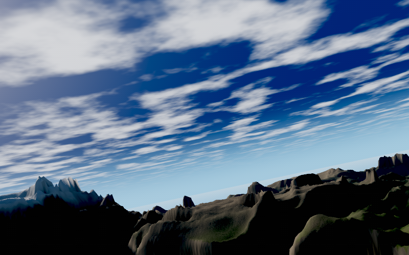

# Rig caméra et animation

VistaForge distingue trois objets, comme un rig LightWave :

1. **Point de vue (Eye)** — une courbe 3D à clés temporelles et poignées
   Bézier. C'est l'objet que l'on dessine.
2. **Cible (Target)** — point fixe, courbe propre, ou poursuite du point de vue
   avec une avance en secondes.
3. **Caméra (Optics)** — liée rigidement au point de vue ou suspendue sur un
   ressort, avec FOV, profondeur de champ, roulis explicite et offset.

La dynamique du **corps** (drone, oiseau, hélicoptère, dirigeable, chasseur,
manuel) limite l'accélération de chaque axe et produit le roulis en virage.
Le tout est déterministe : à seed et temps égaux, la caméra est identique.



## Presets de dynamique

| Preset | Vitesse max | Accél. avant | Accél. latérale | Accél. verticale | Roulis max | Signature |
|---|---:|---:|---:|---:|---:|---|
| `drone` | 30 m/s | 25 m/s² | 30 m/s² | 20 m/s² | 75° | nerveux, jerk 60 |
| `bird` | 18 | 8 | 12 | 10 | 55° | inertie moyenne, turbulence |
| `helicopter` | 22 | 4 | 6 | 5 | 25° | lourd, nacelle stable |
| `airship` | 12 | 1,5 | 1,5 | 1 | 8° | très lent, dérive |
| `fighter` | 90 | 40 | 60 | 30 | 85° | haute énergie, jerk 140 |
| `manual` | 200 | 200 | 200 | 200 | 0° | suit la courbe sans ressort |

Le corps suit la courbe par un **ressort critique** ; l'accélération demandée
est projetée sur les axes avant / latéral / vertical, bornée par le preset,
puis limitée en jerk. L'écart entre la courbe et le corps est le « lag »
naturel du drone ou du dirigeable.

## Roulis

Le roulis automatique vaut `atan(a_lat / g) × bank_gain`, borné par
`max_bank_deg` et lissé par `roll_response`. Le roulis explicite de l'optique
s'ajoute. Un preset `manual` conserve la courbe et n'ajoute pas de gîte.

## Contraintes

- **Hauteur au sol** : le point de vue, la caméra et/ou la cible sont remontés
  au-dessus du terrain + `ground_clearance_m`, avec une douceur réglable.
- **Sol de référence fixe** : un plan d'altitude `reference_z_m` peut remplacer
  ou compléter le terrain (utile pour un survol au-dessus d'une mer).
- **Parois** : `wall_distance_m` et `wall_avoidance` construisent un champ de
  distance (chamfer) aux cellules de pente > 45° ; le rig échantillonne devant
  le point de vue et applique une accélération latérale répulsive. Le champ est
  2D : il ignore l'altitude et peut pousser au-dessus d'une falaise.

## Édition graphique

L'espace **Animation** affiche le terrain en 3D dans le viewport de conception :
tracé de l'œil en cyan, cible en orange, viseur du point de vue, clés `E0/T0…`
et gizmo de translation. On peut :

- tracer une clé au clic sur le terrain (altitude réglable) ;
- sélectionner une clé et la déplacer sur X, Y ou Z avec le gizmo, avec aimant ;
- insérer une clé au temps courant, en supprimer une (minimum deux) ;
- choisir un preset et générer une trajectoire orbite / crête / piqué ou un
  **tracé de démonstration (S)** adapté au profil ;
- régler durée, images/s, FOV, profondeur de champ, roulis, liaison caméra ;
- régler chaque accélération, le jerk, le gain et le roulis max ;
- comparer les trajectoires des cinq corps et lire l'animation dans le viewport.

Le parcours complet, la barre de lecture et l'export sont décrits dans
[`ANIMATION.md`](ANIMATION.md).

## CLI

```bash
# Appliquer un preset et une trajectoire orbitale
cargo run --release -p vf-cli -- rig preset ile.vfproj helicopter --path orbit

# Ajouter une clé
cargo run --release -p vf-cli -- rig key ile.vfproj --time 4 --x 5000 --y 5000 --z 1200

# Inspecter
cargo run --release -p vf-cli -- rig info ile.vfproj

# Rendu d'une image du rig (le projet doit avoir rig.enabled)
cargo run --release -p vf-cli -- anim still ile.vfproj plan.png --time 2.4

# Séquence
cargo run --release -p vf-cli -- anim render ile.vfproj frames/ --seconds 8 --fps 24
```

`anim` utilise le rig s'il est activé, sinon l'ancien module de vol
(`flight`). La séquence rig est rendue image par image avec la même simulation
déterministe ; le flou de mouvement du module `flight` n'est pas encore branché
sur le rig.

## Limites

- Pas de flou de mouvement sur le rig pour l'instant.
- L'évitement de parois est actif mais son champ de distance est 2D (il ignore
  l'altitude).
- Le DOF est calculé et exporté dans `RigSample` ; le rasteriseur CPU ne
  l'applique pas encore, mais le bridge Blender importe la caméra et ses
  réglages.
- Pas d'IK, pas d'expressions, pas de graphe de scène complet : le trio
  eye/target/optics couvre le cas cinématique visé.
