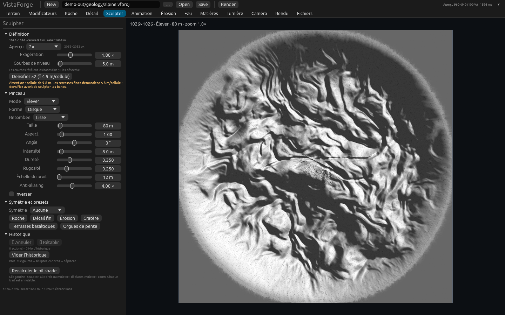

# Sculpter finement les terrasses et les falaises

L'espace **Sculpter** travaille directement sur le heightfield. Un pinceau de
80 m garde sa taille physique quand le terrain est rééchantillonné ; chaque
trait est annulable et ne stocke que la région touchée.



## Le problème de définition

Un banc de 5 m ne peut pas exister dans une grille à 25 m/cellule : le maillage
ne contient aucun échantillon entre le haut et le bas du banc. Densifier est
donc la première opération, avant de sculpter.

| Cellule | Bancs résolus | Usage |
|---|---|---|
| 25 m | > 50 m | reliefs de plaine |
| 9,8 m (1 026² sur 10 km) | ~20 m | montagnes, grandes terrasses |
| 4,9 m (2 050²) | ~10 m | falaises, bancs moyens |
| 2,4 m (4 096²) | ~5 m | bancs fins, orgues |

Le panneau **Définition** affiche la cellule courante, un avertissement au-delà
de 8 m et un bouton **Densifier ×2** (rééchantillonnage bicubique jusqu'à
4 096²). La densification est une étape de l'historique global : `Ctrl+Z`
restaure la grille précédente, avec les traits antérieurs qui redeviennent
cohérents. Les traits suivants sont enregistrés sur la nouvelle grille.

## Aperçu

- **Aperçu 1×/2×/3×** : hillshade supersamplé par interpolation bilinéaire entre
  les centres de cellules, avec des normales lissées. Le motif en pochoir du
  hillshade 1×/cellule disparaît.
- **Exagération** (0,5–4×) : relief ombré. Utile pour lire les petits bancs.
- **Courbes de niveau** (mètres, 0 = désactivé) : une ligne tous les N mètres,
  renforcée toutes les 5 lignes. C'est le meilleur moyen de vérifier qu'un banc
  est continu avant de le rendre.
- Le viewport GPU est passé à 2 049 segments : un terrain 2 050² est affiché
  à sa résolution, sans sous-échantillonnage.

## Terrasse stratifiée

Le mode **Terrasse** quantifie la hauteur dans un repère incliné :

- **Épaisseur des bancs** : pas vertical de la quantification.
- **Inclinaison / azimut du pendage** : les bancs suivent un plan incliné.
- **Banc / falaise** (0,3–0,99) : part du banc plat avant le riser.
- **Variation des bancs** : bruit basse fréquence sur l'épaisseur.
- **Netteté des risers** (0–1) : 0 = pente large, 1 = marche quasi verticale.
- **Orgues verticales** : espacement, profondeur et irrégularité des joints
  verticaux. Les rainures sont creusées sur les risers et suivent la stratification.

Les coordonnées sont **monde**, pas locales au stamp : deux traits qui se
chevauchent alignent leurs bancs. Le preset **Terrasses basaltiques** règle des
bancs de 8 m, un pendage de 3°, des colonnes de 18 m et une profondeur de 2,5 m.

Astuce : à 4,9 m/cellule, utilisez des bancs de 8–12 m et une netteté de 0,8–
0,9. À 2,4 m/cellule, descendez à 4–6 m.

## Orgues de pente

Le mode **Groove** avec un espacement > 0 aligne les sillons sur la **descente
locale** (gradient du terrain), comme les joints d'une coulée basaltique. La
profondeur est pondérée par la pente : les replats ne sont pas rainurés. Sans
espacement, l'ancien mode bruit reste disponible.

## CLI

```bash
# Densifier avant de sculpter
vistaforge terrain resample scene.vfproj --width 4096 --filter bicubic

# Terrasses basaltiques
vistaforge terrain sculpt scene.vfproj \
  --x 3100 --y 3550 --x2 3500 --y2 3900 \
  --mode terrace --radius 180 --strength 1 --step 6 --dip 5 \
  --bench-ratio 0.92 --bench-variation 0.5 --riser-sharpness 0.9 \
  --column-spacing 8 --column-depth 2.5 --column-jitter 0.5 \
  --hardness 0.55 --roughness 0.05 --aa 4

# Orgues alignées sur la pente
vistaforge terrain sculpt scene.vfproj \
  --x 3100 --y 3550 --x2 3500 --y2 3900 \
  --mode groove --radius 90 --strength 3.5 \
  --column-spacing 12 --column-jitter 0.4 --aa 4
```

## Validation

- Tests unitaires : bancs plats + risers raides, canaux périodiques,
  déterminisme, hillshade supersamplé, courbes de niveau.
- `cargo test -p vf-terrain` couvre le moteur indépendamment de l'UI.
- Rendu de contrôle : `vistaforge render` sur un versant densifié à 2–3 m/
  cellule, caméra à 200–400 m de la paroi.

## Limites

- Un heightfield ne peut pas représenter un surplomb. Les corniches sont des
  niches (`undercut`) ou des falaises verticales à une cellule.
- Le hillshade 2× sur 2 050² alloue ~16,8 M de pixels (67 Mo en RGBA) : la
  génération prend un instant après un trait.
- Le maillage GPU à 2 049 segments peut être lourd sur une petite carte
  graphique ; le rendre final reste côté CPU et déterministe.
